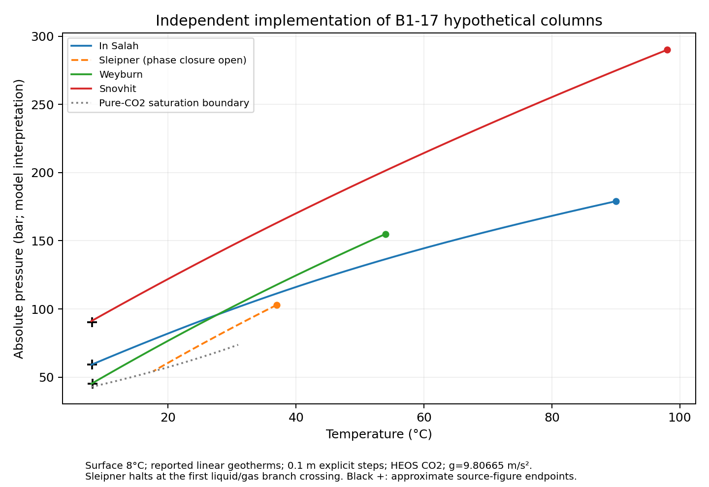

# Ketzin injection operation: comprehensive reading findings

All eleven physical pages of Liebscher et al. (2013), B1-17, have been read and visually inspected, including enlarged tables, equation, captions and legends. The [item record](comprehensive_review/B1-17.md) covers eight figures, two tables, 21 section groups, 15 claim assessments, one unnumbered source recurrence and thirteen analyst identities. Source SHA-256: `501636ee3d0ca636ffb0ba0ce6cac1cf4bd692346542d5aa1ca4f7feb7a1dc2b`. The original PDF and rights are unchanged; the new column figure is independently calculated, not copied article artwork.

The paper remains **incomplete under the comprehensive-audit standard**. All 28 underlying author-year originals, ten additional dependencies and external assets remain unverified. The [45 limited checks](../outputs/comprehensive_review/B1-17_checks.csv) and [reconciliation](../outputs/comprehensive_review/B1-17_reconciliation.json) distinguish three reconstructed hypothetical columns from native monitoring, test fitting and reservoir-model reproduction.

## Monitoring references and data boundaries

The source stores measured WHP/BHP relative to atmosphere and adds an assumed constant **1 bar** for its absolute-pressure presentation. Wireline logging campaigns already report absolute pressure. These bases must not be mixed or converted twice.

The Weatherford sensor is at550 m, while the paper approximates pressure at630 m by adding **2 bar**. Authors explicitly say that the true dynamic difference depends on injection rate and temperature, and that this derived630 m series is not stored in SCADA. Their native ASPEN PLUS/Peng-Robinson calculation is referred to rather than supplied. Under a uniform hydrostatic identity,2 bar over80 m implies about255 kg/m3; that is a dimensional interpretation, not measured density or reproduction of the ASPEN calculation. B1-14's550-to640 m reference is a different interval; no correction is substituted between cases.

The Coriolis meter is8 m upstream of the injector and has nominal accuracy±0.35% of measured flow. Integrated flow and delivery-ticket/tank-level accounting are described as separate cumulative-mass methods. Without raw records, corrections, non-injection outflows and quality metadata, instrument accuracy does not establish the uncertainty of the complete reported injected mass. Neither method alone supplies retained carbon.

Section3 explicitly stores arithmetic **five-minute SCADA means**. Figure3A separately says downhole P–T data were taken every **five seconds**, and DTS profiles have a three-minute cadence. These are different acquisition/aggregation products. The source does not independently establish a complete five-second flow archive, and it does not disprove B1-14's own raw-acquisition statement. Figure3A's caption datesJuly–August2011 whereas its axis and first-weeks context show2008; the discrepancy remains open. Table1's caption says campaigns untilJune2013, while its seven listed dates endOctober2011 and prose describes another period. No date is silently repaired.

All sixteen pressure/temperature pairs and blank cells in Table1 are preserved. The wells use620/630/620 m references, and campaigns span several dates. These values cannot be treated as simultaneous pressure gradients without native timestamps and datum mapping.

## Equipment, tests and maximum service

The reported61396 t is as ofSeptember2012, including1515 t of oxyfuel CO2 duringMay–June2011. Later approximately67000 t reported in other Ketzin studies has a different time scope. Food-grade and oxyfuel purity thresholds do not supply complete species or a mass/mole impurity basis.

The plant setpoint ceiling3250 kg/h, two50 t tanks,300 kW maximum electrical heater, four ambient preheaters and−18°C delivery/about35°C injection endpoints are equipment descriptions. The conditional nameplate ratio is92.31 kWh/t **only if both maxima coincide**; it is not observed utility consumption. The53 K temperature difference is not an enthalpy duty. Actual pumping/compression, power, ambient heat, phase/pressure, losses and restart duties remain absent. No complete capture-to-injection heat/electricity inventory is claimed.

The four isochronal stages prescribe4 h injection at900/1600/2400/3200 kg/h, each followed by4 h shut-in. Arithmetic gives32.4 t over32 h. The four14-day research cycles total56 days, compatible with the55 elapsed days between23 August and17 October2010 under inclusive counting. These test schedules are not annual availability or downtime distributions.

The homogeneous, infinite-boundary radial fit reports29.6 mD andPi73.8 bara, with a first-cycle mismatch. Native geometry, histories, fluid properties, weighting and solver are missing. Most importantly, the authors explicitly state that equipment-limited impulses and injection-versus-withdrawal differences prevent classical performance interpretation and **do not allow a forecast of maximum injection pressure or reservoir behaviour**. Neither this fit nor the typical1–3 t/h history calibrates maximum annual service. The observed73–79 bara range is not a fracture or authorised BHP limit.

## Independent hypothetical-column calculation

The source provides a simple upward hydrostatic recurrence for four hypothetical pure-CO2 observation wells, with an8°C surface and a linear temperature–depth profile to the reported Table2 endpoint:

`P(z2) = P(z1) − rho(z1)*g*abs(z1−z2)`, with `abs(z1−z2)=0.1 m`.

The independent implementation converts bar toPa and°C toK, interprets Table2 pressure as absolute for the EOS and uses standard gravity9.80665 m/s2. The source names g without a value, so this constant is disclosed. Density uses the project's pinned CoolProp8.0.0 HEOS/CO2 backend, whose recorded EOS identifier is `Span-JPCRD-1996`. Library metadata does not certify reading of the underlying EOS paper or exact correspondence to author software.

| Hypothetical case | Independent surface pressure | Status |
| --- | ---: | --- |
| In Salah |59.0921 bar | Single-phase recurrence completed |
| Weyburn |45.1314 bar | Single-phase recurrence completed |
| Snovhit, source spelling |91.1023 bar | Single-phase recurrence completed |
| Sleipner | Not assigned | Stopped at liquid/gas branch crossing |

The three completed columns have surface density greater than bottom density under the imposed thermal profile. Step refinements from0.1 m to0.2/0.05 m change their surface pressures by less than0.002 bar. This is a discretisation check, not empirical uncertainty or a dynamic stability proof.

Source Figure8 is vector artwork. Its displayed Bezier endpoints, calibrated to the plot ticks with recorded PDF coordinates, give approximate surface pressures59.196/45.135/90.392 bar. Differences from the independent values are−0.104/−0.003/+0.711 bar, within an explicitly analyst-selected2-bar graphic tolerance. The endpoints have slightly different displayed temperatures near8°C and are illustrative drawing geometry, **not native author arrays**. No pointwise author-model validation is claimed.

Sleipner reaches a liquid/gas branch crossing at approximately332 m,17.628°C and54.170 bar in the0.1 m march. The final implementation stops before continuing with that branch. At coexistence, P and T alone do not determine bulk density without quality/interface or equivalent closure. No forced phase, guessed quality or clipped saturation path is inserted. An earlier unrestricted exploration alternated branches and eventually raised the backend's near-saturation error at327.7 m; that failed attempt is retained in the reconciliation, not reported as a completed two-phase profile. Step refinements also remain phase-blocked.

The [65863 retained node rows](../outputs/comprehensive_review/B1-17_columns.csv.gz) contain the three completed single-phase columns and successful pre-crossing Sleipner nodes, with no fabricated surface value. These are an independent implementation of the specified static component under disclosed assumptions. They do not reproduce the full two-phase model, transient heat-pipe/stability/failure calculation, native ASPEN correction, radial fit or monitored reservoir history. The1500/2000 m phase-depth recommendations remain conditional on historic idealised site, thermal, pressure and composition choices; no universal safety threshold follows.

## Detection, restart and citation implications

P300 pressure is reported at42.05–42.12 bara with gaps. No correlated response to the observed reservoir changes is reported. Caption/discussion assertions that this proves no connection or leakage do not supply a quantitative transfer or leakage detection bound. No zero-leakage probability, post-injection retained fraction or whole-chain GHG inventory is inferred.

The150 m gas-membrane detections, precursor WHP responses and well-filling behaviour have different definitions from geological first arrival. Continuous injection began30 June after commissioning injections; other studies use24 June clocks. These dates cannot silently reproduce21.7/271-day sensor labels. Likewise, a roughly one-third cyclic response-span ratio and one-day observer delay do not define a full pressure-transfer function.

DTS records support operational conditioning, two-phase interpretation and restart control. Reported lower/more stable heater temperatures and faster restart are qualitative improvements without numeric energy/time savings. Indirect sensitivity to lithology, cementation or future corrosion/leakage is not independently validated failure probability.

One new [B1-14→Liebscher2013 citation check](../evidence/comprehensive_review_inputs/B1-14_Liebscher2013_citation_check.json) directly supports the8 m meter and550 m sensor while preserving sampling and depth-reference qualifications. It does not validate the native inversion or complete B1-17's underlying source chain. The audit now has seven scoped citation edges overall.

All28 underlying entries are retained in the [reference register](../evidence/comprehensive_review_inputs/B1-17_bibliography.json). The exact Möller2012 operational-dataset DOI is a located lead, not a retrieved dataset. Literature and courtesyStatoil/Cenovus site values retain provenance. No embedded file or explicit supplement/code notice was identified; external supplements, errata, originals and native cases remain unverified during the requested Chrome wait. Local absence does not establish public absence.

Paper1 uses these findings for pressure-reference, phase and measurement discipline and explicit exclusion of test-based maximum-pressure forecasting. Accepted operating/GHG numerical inputs remain unchanged. Continue B1-18 while the remaining source, phase, native-data and model checks stay open.

The original paper prints the operational-dataset lead [10.2312/GFZ.b103-12066](https://doi.org/10.2312/GFZ.b103-12066). This link is preserved from the bibliography; the dataset has not been retrieved or verified in this checkpoint.

Validation: source-hash/register checks,139 tests, recurrence refinement and document/workbook builds pass. These checks do not close the missing native models, source chains or phase rule.
