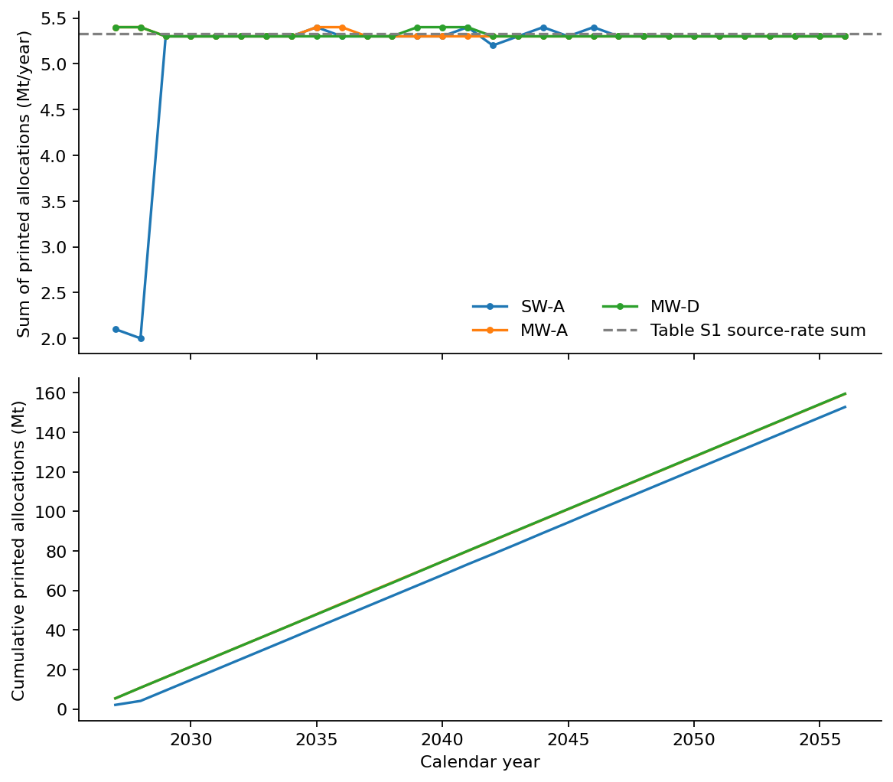

# Budiarto supplementary material: extraction and modelling implications

Received 4 November 2026: `43979_2025_135_MOESM1_ESM.docx`, linked to DOI 10.1007/s43979-025-00135-w. [Retained original](../original/supplements/43979_2025_135_MOESM1_ESM.docx). This supplements an existing publication; the library remains 92 unique publications and 93 PDF files, with one additional supplementary DOCX.

## What is now available

| Evidence | Extracted information | Dataset |
|---|---|---|
| Table S1 | 14 sources: industry, CO₂ rate and capture cost | `supplement_sources.csv` |
| Table S2 | 8 reservoirs: type, storage resource, estimated start year and storage cost/range | `supplement_reservoirs.csv` |
| Table S3 | 46 numeric distances to hubs; two dash cells retained as missing | `supplement_distances.csv` |
| Figures S1–S7 | Pressure versus storage efficiency/rate figures for r1, r2 and r4–r8 | Original embedded EMF/PNG media retained |
| Figures S8–S10 | Annual MILP injection allocation heatmaps for SW-A, MW-A and MW-D, 2027–2056 | `supplement_annual_injection.csv` |

The three native DOCX tables yield **102 numeric records**. The annual heatmaps have **720 cells: 250 printed one-decimal allocations and 470 blank cells**. Only the 250 printed values enter the numeric extraction ledger. The document therefore adds **352 numeric records**, bringing the full ledger to **1,642 records**. These are records, not independent observations.

## Source and storage consistency

Table S1 source rates sum to **5.327 Mt/year**. Across the paper's **30 calendar-year bins, 2027–2056**, this gives **159.81 Mt**, exactly matching the main paper's reported multi-well storage total. The main paper defines ms,t as captured source mass in its network balance; a second multiplication by 90% is unsupported without changing that definition.

The eight candidate reservoir resources sum to **537.4 Mt**. Estimated readiness spans **2027–2039**. These are model resource/readiness inputs, not annual injection rates or verified commercial storage allocations. Costs do not supply capture or injection GHG inventories.

| Scenario | Annotated cells | Sum of printed annual allocations (Mt) | Main paper total (Mt) | Printed minus main (Mt) |
|---|---:|---:|---:|---:|
| SW-A | 100 | 152.8 | 153.21 | −0.41 |
| MW-A | 76 | 159.4 | 159.81 | −0.41 |
| MW-D | 74 | 159.5 | 159.81 | −0.31 |

The reported totals lie within conditional worst-case rounding envelopes for the printed cells. This is compatibility with display precision, not an independent reproduction of the solver. The rounded allocations have not been normalised to the totals. For example, a rounded annual sum of 5.4 can exceed the nominal 5.327 Mt/year source flow without proving a physical mass-balance failure. Exact comparison requires raw model values.

No printed positive allocation occurs before its reservoir's Table S2 estimated start year. Blank cells remain blank in the retained dataset. Aggregation sums printed entries and interprets a blank as no reported allocation for reconstruction; it does not create a measured zero flow or an independent physical capacity limit.

## Extraction and verification

Native tables are extracted directly from DOCX XML through python-docx. All ten original image files are preserved with hashes. Each annual value has a scenario, reservoir, year, original figure/image and pixel bounding box. Small-cell OCR was not reliable and was not accepted as evidence. The final transcription was read from the source annotations, with row/year mapping checked in enlarged analytical views.

An auxiliary check verifies all 720 occupied/blank positions. For the 250 annotated cells, comparison with the apparent reversed-viridis colour scale and the source's 0–5 legend gives a maximum difference of about 0.067 Mt/year from the printed value. This helps detect row/column transcription errors. It does not recover raw model precision; only the printed one-decimal annotations are used in analysis. The palette interpretation is a verification aid, not an empirical model input.

A conditional rounding envelope assumes conventional nearest-0.1 printing, giving ±0.05 per annotation. It is derived from display precision and is not a confidence interval or probability distribution. Blank interpretation and the rounding convention remain explicit conditions.

## What this closes and what remains

**Closed:** the missing supplementary source table, reservoir resource/readiness/cost table, hub-distance table and rounded annual allocation outputs. The source totals and main-paper multi-well storage total are now internally reconciled at their reported precision. The draft now includes a reproducible annual replay.

**Still needed for new optimisation:** the independent annual physical upper bounds kr,t, exact raw allocations for precise validation, complete network/junction and process inputs where absent, and the additional capture/conditioning/transport/well/pressure-management GHG inventory. The heatmaps show optimised allocations mr,t, not kr,t. Using allocations as independently derived injection limits would predetermine aspects of the outcome.

The pressure/rate figures are not complete calendar-time constraint arrays. Their original vector/raster media are preserved; no annual service series is invented from them. A Japanese application still requires a disclosed source/geology/route proxy design. Neither this supplement nor the annual replay resolves the existing fugitive-source-loss accounting issue in the Norwegian aggregate GHG factors.

The most useful optional contribution from the user is an original author spreadsheet or solver export containing raw annual allocations and input constraints. Extraction, accounting reconciliation, modelling and validation can continue as researcher tasks. Journal and author details are needed later for manuscript formatting.
