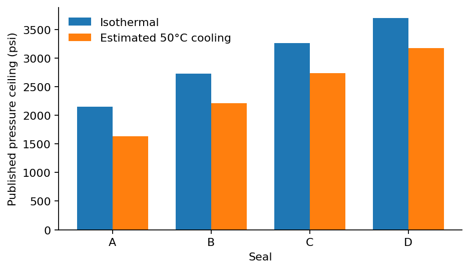
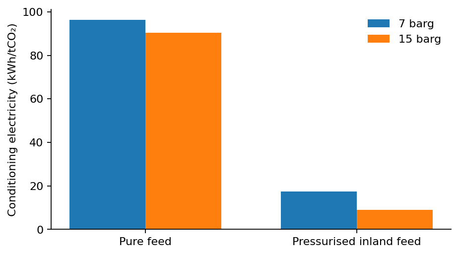

**Draft status.** This manuscript reports calculations from published values, a source audit and an explicitly labelled proxy comparison. Its annual domestic-versus-export simulation is specified but has not been run. The quantitative proxy uses South Sumatra storage outcomes and Norwegian post-capture GHG scenarios; these are not observations of Japanese reservoirs. Author names, affiliations and target-journal formatting remain to be supplied. Source IDs identify the retained PDFs and physical PDF pages in the accompanying repository.

# Abstract

Cross-border CO₂ storage may enable additional mitigation when domestic injection service is constrained, but the benefit depends on transport operations, usable storage service and consistent greenhouse gas accounting. This study develops an auditable comparison framework and tests its accounting with published-case benchmarks. A supplied library of 92 unique publications is screened, with targeted extraction from 48 and abstract/relevance screening of 44. Every calculation uses located published values. An Indonesian source–sink optimisation reports 153.21 Mt stored with single-well development and 159.81 Mt with multi-well development, a calculated increase of 6.60 Mt (4.31%). Published conditioning cases differ substantially with inlet state, while a separate thermal assessment reduces pressure ceilings by 14.13–24.20%; these pressure changes cannot be interpreted as equal changes in injection rate. Cross-pairing the Indonesian storage outcomes with Norwegian reported post-capture intensities gives a diagnostic score crossing at 72.74 kgCO₂e per tonne stored, relative to a 32.8 kgCO₂e/t reference. This is not a whole-chain mitigation threshold: the reported GHG inventory includes fugitive CO₂, and additional capture and well burdens require reconciliation. The resulting framework identifies the evidence and controls needed to determine whether resolving both annual deliverability and operational shipping changes a storage decision. No preferred Japanese export destination is established.

**Keywords:** geological CO₂ storage; source–sink matching; deliverability; shipping; lifecycle accounting; carbon break-even; reproducible research.

# 1. Introduction

The amount of CO₂ that can be stored in principle is different from the amount an industrial source can inject at a particular time. Reservoir pressure, well development, commissioning, temperature and water handling can restrict usable storage service even where a large prospective resource is reported. For domestic and foreign pathways, the relevant climate comparison therefore concerns the CO₂ retained and the additional greenhouse gas emissions incurred in enabling that retention. Storage resource or transport distance alone cannot resolve this comparison.

Regional screening illustrates the distinction. Zhang and Lau identify 391 Mt/y of stationary emissions within a 1,000 km radius of Singapore and mid storage resources of 0.5 Gt in oil reservoirs, 6.2 Gt in gas reservoirs and 379 Gt in saline aquifers. Arun is a named gas-condensate candidate with a reported 1.3 Gt resource. These estimates identify candidates; they do not supply annual injection service, a commercial allocation or a commissioning schedule [B4-08, p1]. National Malaysian power-sector analysis similarly provides decarbonisation context rather than a matched Japanese industrial-source inventory [B4-01, p1].

The relation between transport and storage characteristics is already established in infrastructure research. Wang et al. examine how distance, injectivity and capacity affect pipeline and sink selection. Nordic studies show that a longer shipping route to a reservoir with favourable injectivity can be economically attractive [B2-01, pp3–5; B3-39, p1; B3-33, p1]. An economic preference, however, does not itself demonstrate greater net climate mitigation. Capture curtailment, route emissions, additional wells and differences in the reference industrial service must also be considered.

Temporal infrastructure planning also has substantial prior coverage. Ooi et al. incorporate source and sink timing, injection rates and capacities using pinch analysis. Lee et al. combine capture retrofits, time-dependent constraints and compensatory power. Becattini et al. optimise yearly infrastructure rollout over a 25-year horizon, including overseas storage, a delayed hypothetical domestic sink and emissions relative to business as usual [B3-11, p1; B3-14, p1; B3-42, pp1–7,15–16]. Bertoni et al. incorporate reservoir physics in infrastructure optimisation [B2-04, pp1,9–10]. Consequently, neither a dynamic deployment model nor a common-reference emissions comparison should be claimed as the first contribution of Paper 1.

The newly supplied South Sumatra study further narrows the gap. Budiarto et al. combine reservoir availability, well-derived injection limits and multi-period source–sink optimisation. Their single- and multi-well configurations produce different cumulative storage outcomes [B4-06, pp8–10,16]. Gabrielli et al. also consider costs, emissions and the ability to store captured carbon under infrastructure failures, including domestic and foreign storage configurations [B4-07, p1]. Additional retention from better storage service is therefore an established mechanism rather than a novel premise.

Operational transport and lifecycle modelling are likewise well developed. Bjerketvedt et al. connect uncertain weather, vessel operation and buffers to transport completion and expected cost. Roussanaly et al. compare pressure, conditioning and ship design; Jeon et al. couple tank and cargo-handling dynamics to marine GHG intensity. Fraga et al. integrate a prospective post-capture inventory with multi-period cost/GHG optimisation, and Nöhl et al. evaluate cumulative carbon payback from changing transport infrastructure [B2-08, pp6–8; B3-38, pp7–9; B3-29, pp4–10; B2-12, pp5–18; B2-13, pp3–5]. More operational detail is thus a modelling choice whose decision value requires evaluation.

A narrower question remains useful: under a common industrial-production counterfactual, when does jointly resolving annual storage deliverability and operational shipping change the magnitude, sign or robustness of the difference between domestic and foreign mitigation? This question allows an unchanged ranking or small interaction. Kolster et al., for example, find limited long-horizon sensitivity to substantial multi-year injection-rate variation in the studied Bunter cases [B3-37, pp3–7]. A model-comparison study should retain such a null-effect benchmark.

This draft makes three present contributions. First, it creates a page-located evidence register that distinguishes observations, published model inputs, published outputs and calculations. Second, it quantifies selected storage, pressure, conditioning, buffer and BOG benchmarks without synthesising unsupported annual profiles. Third, it derives a transparent proxy score and shows why converting that score into net avoided emissions requires further mass and inventory reconciliation. It then specifies the controlled annual model comparison needed for a regional extension. The exact absence of this model-comparison question from all prior literature is not asserted by the supplied-library review.

# 2. Evidence and methods

## 2.1 Library, extraction and scope

The retained library contains 93 PDF files representing 92 unique publications and 1,301 physical pages across the unique publications. The two supplied versions of the source–sink matching review B2-17/B3-46 are counted once as a publication and retained as separate files. Previously downloaded originals are reused for same-title reuploads; binary equivalence of every reupload has not been established. The retained PDFs, identified by SHA256, define the evidence used here.

Targeted methods/results extraction covers 48 unique publications. Another 44 have abstract/relevance screening, so the review is a purposive synthesis of supplied materials rather than an exhaustive systematic review. The ledger contains 1,290 extracted records, including ranges and grouped cases. This number is not a count of independent observations. The Google Drive folder and oversized planetary-limit ZIP were not ingested; the standalone planetary-limit PDF is included. No uninspected contents are represented as evidence.

A separate curated table records 250 atomic quantities, their original units, physical page/table, scenario, evidence type, inventory boundary and transfer limits. A 134-row subset enters the present analysis: 59 quantities support 49 calculations, and 75 entries preserve the published large-ship fleet table. The broad extraction ledger is not a ready-to-run harmonised input file. Values marked HOLD and context-only quantities cannot enter the calculation script. The source audit records 37 unresolved or consequential interpretation issues; an issue can remain open where the affected data are excluded from the calculation.

The calculations preserve original denominators. Unit conversions and algebraic definitions are distinguished from empirical inputs. Published minima and maxima are not treated as probability distributions. No cost factor is converted into GHG, no national resource is assigned as a source's annual allocation, and no missing graph scale is filled with an assumed value. Reported numbers retain their source precision even where machine-readable outputs carry additional computational decimals.

## 2.2 Selecting source and sink evidence

The intended Japan–Malaysia–Australia application is screened against the data required for an implementable model, rather than treated as a fixed set of available services. Higashi-Niigata is a named Japanese candidate with history-matched reservoir forecasts. Its pressure-relief case reports approximately 25–30% greater injection volume, but the supplied figures do not provide recoverable numerical vertical scales for complete absolute annual mass series [B1-07, pp6–9]. Assigning an arbitrary Mt/y scale would therefore be unsupported.

Malaysian Field X studies provide pressure constraints and thermal mechanisms but are anonymised; the studies cannot be assumed to describe one contracted storage service [B1-09, p13; B1-11, pp5–6]. The South-West Hub model supplies an Australian conceptual reference while excluding thermal stresses, so it cannot simply be combined with Malaysian thermal limits as a calibrated Australian sink [B1-12, pp18,21–22]. Regional resources and historical governance assessments do not establish present storage access.

The user authorised explicitly disclosed geographic proxies when local data are unavailable. The present numerical draft therefore selects the internally coherent South Sumatra single- versus multi-well outcomes as the storage-service benchmark. It uses published Norwegian post-capture GHG outcomes as separate burden scenarios. These substitutions test accounting sensitivity; they do not make Indonesian geology Japanese, or Norwegian energy factors applicable to an Asian route. No African dataset is introduced merely because a geographic proxy is permitted.

| Required component | Evidence selected | Role | Remaining transfer limit |
|---|---|---|---|
| Common source–sink storage comparison | Budiarto B4-06, p16 | Published lower/higher cumulative storage | Indonesian industrial system; full annual profiles absent |
| Post-capture burden scenarios | Fraga B2-12, pp18,20 | Reported GHG intensity scenarios | Different country/network portfolios; includes fugitives |
| Feed/pressure conditioning | Roussanaly B3-38, p7 Table 3 | Within-feed process comparison | Different inlet states cannot be pooled as one uncertainty range |
| Thermal pressure constraint | Tan B1-11, pp5–6 Tables 2–3 | Within-seal pressure sensitivity | Analytical field-specific ceiling, not an annual rate factor |
| Buffer and transport completion | Bjerketvedt B2-08, pp7–8 | Denominator and completion benchmark | Original route/weather assumptions |
| BOG process emissions | Jeong B1-19, p7 Table 6; p13 Table A6 | Partial-process intensity | Excludes full propulsion/upstream chain |
| Large-ship fleet counts | Noh and Kang B4-09, p6 Table 7 | Published integer fleet outputs | Density discrepancy prevents independent reconstruction |

## 2.3 Published-case calculations

The thermal benchmark compares the same seal under isothermal conditions and estimated cooling. For each seal, the pressure-ceiling reduction is the printed isothermal ceiling minus the printed cooled ceiling, divided by the former when expressed as a percentage. This percentage describes the stated pressure ceiling, not pressure headroom above initial reservoir pressure, and not an injection-rate reduction. Original psi labels are retained because pressure datums are not sufficiently clear to justify further conversion [B1-11, pp5–6].

Conditioning comparisons use four electricity requirements from the same source table: pure feed and pressurised inland feed, each at 7 and 15 barg. Differences are calculated within each feed case; pure-to-inland ratios are descriptive comparisons of different inlet conditions [B3-38, p7 Table 3]. No electricity emission factor is added, because a compatible regional/year background has not been selected.

Buffer ratios divide the reported buffer by the 5,000 t ship capacity. The 99% and 100% transport-completion cases are kept separate. The paper's use of average-cycle captured mass as another denominator is not relabelled as ship capacity [B2-08, pp7–8].

For the BOG benchmark, annual purge-plus-auxiliary-generation CO₂ from Table 6 is divided by transported mass from Table A6 for the same process and impurity case. Emissions are in t/y and mass in thousands of t/y; the resulting numerical ratio is kgCO₂/t transported. These are partial-process CO₂ intensities. They are neither full lifecycle CO₂e factors nor fractions of cargo necessarily lost to atmosphere [B1-19, pp7,13].

The large-ship benchmark quotes Table 7 directly. Noh and Kang print 1,154 kg/m³ in Table 1 and 1.1546 kg/m³ in the fleet-method prose. Both density records are on HOLD. Table 7 remains a citable published output, but reproducing its cargo/fleet calculation would require resolving the conflict rather than silently correcting it [B4-09, pp3,6].

## 2.4 Mitigation accounting and a deliberately bounded proxy score

For an actual pathway s under common industrial production, net avoided GHG is defined by an explicit no-CCS counterfactual:

$$A_s=\sum_t(E_{0,t}-E_{s,t}). \tag{1}$$

Under a fossil-source counterfactual where each retained tonne displaces one emitted tonne and all additional burdens are consistently counted, this can be reconciled as retained source CO₂ minus additional lifecycle GHG. Captured-source CO₂ vented or leaked must reduce retained mass; it must not also be subtracted as the same source loss within additional GHG. Upstream fuel methane and other incremental emissions remain additional burdens. Biogenic sources, direct air capture, displacement and co-products require their own counterfactual treatment.

The selected published aggregate GHG factors do not yet permit this reconciliation. Fraga's reported post-capture inventory includes fugitive emissions associated with intermediate facilities, transport and injection, as well as energy and construction terms [B2-12, pp8,16–18,23]. The Budiarto outcome is reported CO₂ stored. Combining these without separating source-loss terms can double-count a loss. The present cross-study quantity is therefore defined as a **reported-burden score**, not net avoided emissions:

$$S_i=R_i\left(1-\frac{e_i^{\mathrm{rep}}}{1000}\right), \tag{2}$$

where R is published cumulative stored mass and the reported intensity is in kgCO₂e/t stored. The factor 1,000 converts kilograms to tonnes; it is a unit definition. Equation (2) is an accounting diagnostic constructed from two published datasets. It is not claimed as an empirical result in either source.

For a lower-storage reference L and higher-storage case H, score equality gives:

$$\frac{R_H}{R_L}=\frac{1-e_L^{\mathrm{rep}}/1000}{1-e_H^{\mathrm{rep}}/1000}. \tag{3}$$

Equivalently, the reported-intensity crossing for a given storage ratio is:

$$e_{H,*}^{\mathrm{rep}}=1000\left[1-\frac{R_L}{R_H}\left(1-\frac{e_L^{\mathrm{rep}}}{1000}\right)\right]. \tag{4}$$

These are score crossings. To obtain a physical mitigation comparison, let Linc be captured-source losses already included in reported GWP and also deducted in the retained-mass accounting, and let Gom be additional GHG omitted from the adopted reported factor. After a compatible fossil-source and mass reconciliation:

$$\Delta A=\Delta S+\Delta L_{\mathrm{inc}}-\Delta G_{\mathrm{om}}. \tag{5}$$

The correction may also require revising R if the source's “stored” quantity actually denotes injection without the required retention adjustment. Neither correction is assigned an invented value here. Additional capture utilities, extra well development and pressure-management burdens are examples requiring evidence. Thus a positive score is insufficient to establish positive whole-chain mitigation advantage.

The proxy uses the published single-well SW-A storage outcome for L and the multi-well MW-A outcome for H. The lowest of the six reported Fraga best-solution intensities, Northern Lights at 0.7 MPa, is selected as a transparent reference. This is a normalisation choice, not a claim that the configuration is available domestically or is optimal in another region. Each of the six published outcomes is assigned to H in turn. No unreported intermediate GHG value is sampled and no probability is attached to a scenario.

## 2.5 Reproducibility and checks

Every calculation output records its input IDs, formula, unit and boundary. The repository validates retained PDF hashes, page-text counts, numeric source-token locators and calculation eligibility; these checks establish file identity and traceability rather than the scientific validity of a paper's model. Table mapping for the selected datasets is checked against the retained source pages. The analysis has no fitted parameters, random draws or synthetic annual injection series. Tests check the threshold identity, unit scaling, zero-difference reference case, HOLD exclusion and provenance closure. Figures are generated from the same registered inputs/results.

# 3. Results

## 3.1 Published storage improvement is not a complete mitigation gain

The South Sumatra model reports 153.21 Mt stored for SW-A and 159.81 Mt for the multi-well cases. Their difference is **6.60 Mt**, or **4.31%** relative to SW-A. The study attributes the lower single-well storage to early injection-capacity limitations; this is a coherent published example of storage deliverability affecting cumulative capture/storage outcomes [B4-06, p16]. It is a simulated design result, not a measured field response.

The paper reports costs around USD17.53 billion for SW-A and around USD18 billion for the multi-well cases, with capture dominating chain cost [B4-06, p16]. Those economic values cannot supply the GHG of additional wells or pressure management. Nor can the two cumulative outcomes determine an annual injection profile. The increase establishes the magnitude of a published gross-storage effect and the associated data need; it does not establish a 6.60 Mt net GHG benefit or a Japanese domestic/export difference.

## 3.2 Thermal and conditioning benchmarks

The four paired thermal cases show pressure-ceiling reductions of 521–525 psi, corresponding to 14.13–24.20% of their respective isothermal ceilings. The similar absolute changes produce different percentages because the starting ceilings differ. Transferring one percentage to another reservoir's injection rate would therefore lose both the physical quantity and the field context.

| Seal | Isothermal ceiling (psi) | Cooled ceiling (psi) | Drop (psi) | Drop (%) |
|---|---|---|---|---|
| A | 2,153 | 1,632 | 521 | 24.20 |
| B | 2,731 | 2,209 | 522 | 19.11 |
| C | 3,264 | 2,739 | 525 | 16.08 |
| D | 3,701 | 3,178 | 523 | 14.13 |

For pure feed, the 7/15 barg conditioning requirements are 96.3/90.4 kWh/t. For the pressurised inland-feed cases they are 17.4/9.0 kWh/t [B3-38, p7 Table 3]. The calculated within-feed differences are 5.9 and 8.4 kWh/t, respectively. Expressed relative to the 7 barg value, these are 6.13% and 48.28%. The pure-to-inland ratios at the same shipping pressure are 5.53 and 10.04. These comparisons show why a pressure choice cannot be evaluated without its inlet boundary; they do not show a universal shipping-energy saving.

## 3.3 Buffer, process-emissions and fleet benchmarks

The 99% transport-completion buffer of 5,120 t is **102.4%** of the 5,000 t ship capacity. The 100% completion buffer of 5,890 t is **117.8%** of ship capacity [B2-08, pp7–8]. An approximately 118% figure in the 99% case refers instead to average-cycle captured mass. A percentage without its denominator and completion requirement is therefore not a transferable design parameter.

The terminal literature reinforces this dependence on design and operating conditions. Seo et al. find an optimal temporary tank volume equal to the 11,801 m³ ship volume for their Korean case, which excludes unforeseen well/reservoir malfunctions [B4-02, pp3,8]. Zahid et al. model terminal loading, holding, unloading and emergency shutdown, including vapor return and BOG recycling [B4-03, pp1,3,9]. These results cannot be combined into a universal tank-to-ship ratio or a Japanese weather distribution.

Across the 18 paired Jeong cases, calculated purge-plus-auxiliary-generation intensity spans **1.27–21.25 kgCO₂/t transported**. The variation reflects different pressure/process and nitrogen cases, not repeated observations of one chain. The complete case matrix is provided below to preserve the pairing rather than using its extrema as a statistical range.

| Process case | N₂ 0.05 mol% (kg/t) | N₂ 0.10 mol% (kg/t) | N₂ 0.15 mol% (kg/t) |
|---|---|---|---|
| 1-1 | 7.529 | 14.130 | 21.250 |
| 1-2 | 3.321 | 4.794 | 6.210 |
| 1-3 | 2.923 | 4.400 | 5.941 |
| 2-1 | 1.611 | 2.268 | 2.747 |
| 2-2 | 1.463 | 1.902 | 2.293 |
| 2-3 | 1.268 | 1.528 | 1.767 |

The published large-ship fleet table also shows why annual throughput and distance need explicit representation. At 5 Mt/y, reported fleet counts for the 40,000 m³ design increase from 2 ships at 1,000 km to 24 at 20,000 km; the corresponding 120,000 m³ design uses 1 and 8 ships [B4-09, p6 Table 7]. These are the paper's outputs, quoted without reconstructing the density-dependent calculation. None is evidence that the proposed vessel or route is commercially available. The full 75-case table remains machine-readable in the repository.

## 3.4 Conditional score thresholds from published burden scenarios

The six Fraga best-solution intensities span 32.8–142.1 kgCO₂e/t stored. Their underlying networks, source portfolios and pressure configurations differ, so comparisons do not isolate pressure as a causal variable [B2-12, pp18,20]. With 32.8 kgCO₂e/t as the reference, Equation (3) gives score-equality storage uplifts from zero to 12.74%.

Cross-pairing these intensities with the South Sumatra storage outcomes gives the results below. The 4.31% storage uplift exceeds the score-equality requirement for the two Northern Lights and two combined-concept intensity scenarios, but is smaller than that for the two Stella Maris scenarios. This finding concerns the constructed score only. In particular, the negative Stella Maris score differences do not show that its real infrastructure has negative mitigation or is inferior for its intended source portfolio.

| High-storage burden scenario | Reported GWP (kgCO₂e/t stored) | Storage uplift for score equality (%) | Δ reported-burden score (MtCO₂e) |
|---|---|---|---|
| Northern Lights, 0.7 MPa | 32.8 | 0.00 | +6.384 |
| Northern Lights, 1.5 MPa | 46.3 | 1.42 | +4.226 |
| Stella Maris, 0.7 MPa | 142.1 | 12.74 | -11.084 |
| Stella Maris, 1.5 MPa | 139.0 | 12.33 | -10.588 |
| Combined, 0.7 MPa | 41.5 | 0.91 | +4.993 |
| Combined, 1.5 MPa | 39.2 | 0.67 | +5.361 |

For the fixed published storage ratio, Equation (4) yields **72.74 kgCO₂e/t stored** as the high-storage scenario's reported-intensity crossing. It is useful as an audit target: an analysis claiming an advantage from these particular gross-storage values must examine its incremental inventory near this magnitude. It is not a generic allowable transport emission factor, a calibrated Japanese break-even threshold or a policy limit. Equation (5) determines how reconciling source losses and omitted GHG would change the score comparison.

# 4. Discussion

## 4.1 What the present evidence supports

The literature supports the mechanism behind Paper 1: usable storage service can affect the amount captured and stored, while conditioning, transport, buffers and operational states affect burdens and feasibility. It also shows why those components cannot be combined by selecting a convenient number from each paper. The variables may have different denominators, reference flows, countries, modelling horizons and physical meanings. Source-driven analysis therefore requires more than providing citations: the transferred quantity must still answer the question posed by the receiving model.

The present calculations expose three practical failures that such an audit can prevent. A thermal pressure decrease can be mislabelled as a rate decrease. A buffer-to-cycle-mass ratio can be mislabelled as a buffer-to-ship ratio. A lifecycle factor containing captured-source fugitives can be subtracted from already loss-adjusted retained mass, counting the loss twice. Each produces an apparently numerical answer while changing the underlying question.

The score crossing is consequently a diagnostic intermediate result. It shows how the published storage ratio interacts algebraically with the adopted reported intensities. It cannot decide between actual domestic and foreign services until the inventories are decomposed and geographically compatible. Reporting the correction term is preferable to setting unreported capture, well and water-handling burdens to zero. No Monte Carlo probability, confidence interval or country ranking is inferred from the selected cases.

## 4.2 How to use geographic proxies responsibly

A published non-local reservoir case can test whether a decision is sensitive to a particular service pattern, provided its provenance and limitations remain visible. It cannot establish that a Japanese sink has the same permeability, pressure interference, temperature response or commissioning date. The present Indonesian benchmark is retained under its original identity. If the annual supplementary profiles become available, they may be used as a labelled proxy service envelope, accompanied by structural sensitivity rather than an invented local calibration.

Process proxies require the same care. Norwegian electricity and transport assumptions are scenario inputs here, not replacement estimates for Japanese or Malaysian energy systems. Resource estimates identify where to investigate; they do not allocate storage capacity to the chosen source. Studies of legal liability and governance can organise access questions but cannot certify current permits. A geographic scenario is physically meaningful only after source, route, terminal and storage-service constraints can be satisfied together.

## 4.3 Controlled annual extension: testing the value of model detail

The next numerical stage should preserve the proposal's three objectives: quantify storage-service constraints, quantify transport/conditioning burdens and identify when additional retained CO₂ outweighs additional lifecycle GHG. It should use one common industrial-production/no-CCS baseline for domestic-only, foreign-only and mixed allocation. The proposal's 2030–2050 horizon is a research-design choice, not an extracted operating forecast; the endpoint convention must be stated before implementation. The present published cumulative benchmarks retain their original horizons and are not rescaled to this proposal horizon.

The material balance must distinguish source supply, realised capture, closing inventory, injection, handling losses and captured-stream venting. End-of-horizon material still in tanks or vessels receives no permanent-storage credit without a supported subsequent fate. Annual usable injection is constrained by readiness, wells, pressure/thermal limits and allocated cumulative storage. Downtime cannot be applied both within a published service profile and as an additional multiplier.

Shipping should resolve integer departures, laden and return transit, port operations, pressure compatibility and binding buffer limits. Voyage loading, heel and annual fleet utilisation are different quantities. BOG generation is not automatically atmospheric loss; recondensed gas, returned vapor and retained heel need their own mass states. Zero throughput has undefined per-tonne intensity, not an assumed zero-emission result. Port or pressure constraints can make a fleet-hour solution infeasible even if its aggregate annual capacity appears sufficient.

Four controlled variants permit a direct comparison. B0 uses static injection screening and a fixed transport factor; B1 introduces annual deliverability; B2 keeps B0 storage and resolves operational shipping; B3 includes both. The static proxy and calibration flow must be specified before observing outcomes. Controls should distinguish changing post-commissioning service from commissioning delay and distinguish equal-retention route burdens from additional-storage effects.

Let Dj be foreign minus domestic net mitigation under variant j. The full representation contrast is D3 minus D0. The interaction is:

$$I=D_3-D_2-D_1+D_0. \tag{6}$$

Calling the full contrast an interaction would overstate the effect of coupling. If a simplified variant selects another route or fleet, its selected decision should be evaluated under the same detailed feasibility/accounting model before attributing a climate benefit to model resolution. A null interaction or unchanged robust ranking remains informative. No numerical B0–B3 result is reported in this draft.

The physical break-even condition is additional retained source CO₂ equal to additional consistently counted lifecycle GHG under the common counterfactual. Integer fleets and phased assets may create several crossings rather than one universal distance. A regional application therefore needs supported annual injection series, route-state fuel/energy, local/year backgrounds, pressure-management inventory, asset construction and a retention horizon. Published aggregate outcomes alone cannot identify that frontier.

## 4.4 Limitations

The supplied-library review is selective: 44 unique publications remain at abstract/relevance stage and targeted extraction of the other 48 is not an exhaustive inventory of every supplement or numerical claim. The 1,290 records include contextual values unsuitable as direct model parameters. The score analysis combines independently optimised studies and does not reproduce either original optimisation, whose supplementary inputs and code are not fully supplied.

Several unresolved source issues are deliberately excluded from use, including the Noh and Kang density discrepancy. File hashes and source-token checks establish provenance; they do not validate a reservoir forecast, measured permanent retention, commercial access or model assumptions. Missing quantities are identified rather than assigned plausible-looking values. The manuscript is therefore an evidence-based methods and benchmark draft, with the full regional simulation remaining a specified research stage.

# 5. Conclusions

Published evidence quantifies both the storage-service mechanism and the importance of process boundaries. The selected South Sumatra comparison increases gross storage by 6.60 Mt (4.31%); separate studies provide material thermal-pressure, conditioning-energy and BOG-process differences. These quantities are traceable but are not interchangeable.

A cross-study reported-burden score yields a conditional intensity crossing of 72.74 kgCO₂e/t for the selected storage ratio and reference. Because the adopted GHG factor includes fugitives and does not supply a matched complete regional inventory, this score cannot establish whole-chain net mitigation or a preferred export destination. The source-loss reconciliation and omitted-burden correction are explicit requirements for that inference.

Paper 1 can now proceed from a reproducible evidence base to a controlled test of whether annual deliverability and operational shipping change the domestic–foreign decision. That test must preserve the common source counterfactual and allow both meaningful and negligible effects of additional model detail.

# Data and code availability

The accompanying GitHub research branch contains the retained PDFs, original proposal, source catalogue and page text, full extraction ledger, curated/analysis inputs, issue log, calculated CSV/JSON results, figure sources, tests and editable manuscript. The input register records every empirical quantity used in the calculations. Historical preparation outputs are separately archived and superseded by the current documents. The supplied scholarly documents retain their original rights and licences.

# References

The following references are cited by stable source ID. Full supplied-library titles, identifiers, original filenames and file hashes are in `data/source_catalogue.csv`; complete digests and reading stages are in `docs/evidence_digest.md`. Physical pages cited above refer to the retained PDFs.

- **[B1-07]** Kukuu et al. (2025). Leveraging Oil and Gas Legacy for Advanced CCS in Japan Realistic CO2 Storage Simulation in the Higashi-Niigata Gas Field. [10.2118/225812-MS](https://doi.org/10.2118/225812-MS). [Retained PDF](../papers/B1-07.pdf).

- **[B1-09]** Nik Kamaruddin et al. (2019). 4-D Geomechanics Modelling for Potential CO2 Storage Site in Malaysia – Fault Reactivation and Maximum Pressure Injection Limit. [IPTC-19491-MS](../papers/B1-09.pdf). [Retained PDF](../papers/B1-09.pdf).

- **[B1-11]** Tan, Musa & Nik Kamaruddin (2024). Systematic Feasibility Assessment of Geomechanical Risks for CO2 Injection and Long-Term Storage Incorporating Rock Properties Degradation and Thermal Effects. [ARMA-IGS-2024-0183](../papers/B1-11.pdf). [Retained PDF](../papers/B1-11.pdf).

- **[B1-12]** Hosseinzadeh et al. (2026). Geomechanical Evolution of the South-West Hub Carbon Capture and Storage Reservoir in Western Australia. [10.2118/234571-MS](https://doi.org/10.2118/234571-MS). [Retained PDF](../papers/B1-12.pdf).

- **[B1-19]** Jeong et al. (2025). Optimization and economic evaluation of carbon dioxide BOG Re-liquefaction process considering storage pressure and nitrogen impurity. [10.1016/j.energy.2025.135837](https://doi.org/10.1016/j.energy.2025.135837). [Retained PDF](../papers/B1-19.pdf).

- **[B2-01]** Effects of pipeline distance, injectivity and capacity on CO2 pipeline and storage site selection. [10.1016/j.ijggc.2016.05.006](https://doi.org/10.1016/j.ijggc.2016.05.006). [Retained PDF](../papers/B2-01.pdf).

- **[B2-04]** Optimizing carbon capture and storage infrastructure including physics-based reservoir modelling. [10.1016/j.compchemeng.2025.109293](https://doi.org/10.1016/j.compchemeng.2025.109293). [Retained PDF](../papers/B2-04.pdf).

- **[B2-08]** Optimal design and cost of ship-based CO2 transport under uncertainties and fluctuations. [10.1016/j.ijggc.2020.103190](https://doi.org/10.1016/j.ijggc.2020.103190). [Retained PDF](../papers/B2-08.pdf).

- **[B2-12]** Multi-period, multi-objective optimisation of the Northern Lights and Stella Maris carbon capture and storage chains. [10.1016/j.ccst.2024.100190](https://doi.org/10.1016/j.ccst.2024.100190). [Retained PDF](../papers/B2-12.pdf).

- **[B2-13]** How to transport carbon dioxide with minimal environmental impacts today and tomorrow A prospective life cycle assessment. [10.1016/j.jclepro.2025.145659](https://doi.org/10.1016/j.jclepro.2025.145659). [Retained PDF](../papers/B2-13.pdf).

- **[B2-17]** Progress and perspectives in source-sink matching for CCUS A critical review. [10.1016/j.rser.2025.116313](https://doi.org/10.1016/j.rser.2025.116313). [Retained PDF](../papers/B2-17.pdf).

- **[B3-11]** Planning of carbon capture and storage with pinch analysis techniques. [10.1016/j.cherd.2013.04.007](https://doi.org/10.1016/j.cherd.2013.04.007). [Retained PDF](../papers/B3-11.pdf).

- **[B3-14]** A unified model for the deployment of carbon capture and storage. [10.1016/j.apenergy.2014.01.080](https://doi.org/10.1016/j.apenergy.2014.01.080). [Retained PDF](../papers/B3-14.pdf).

- **[B3-29]** Integrated modelling and simulation of liquefied CO2 tank and cargo handling system with new marine transportation greenhouse gas intensity. [10.1016/j.energy.2025.139624](https://doi.org/10.1016/j.energy.2025.139624). [Retained PDF](../papers/B3-29.pdf).

- **[B3-33]** Ship transport—A low cost and low risk CO2 transport option in the Nordic countries. [10.1016/j.ijggc.2016.08.024](https://doi.org/10.1016/j.ijggc.2016.08.024). [Retained PDF](../papers/B3-33.pdf).

- **[B3-37]** The impact of time-varying CO2 injection rate on large scale storage in the UK Bunter Sandstone. [10.1016/j.ijggc.2017.10.011](https://doi.org/10.1016/j.ijggc.2017.10.011). [Retained PDF](../papers/B3-37.pdf).

- **[B3-38]** At what Pressure Shall CO2 Be Transported by Ship An in-Depth Cost Comparison of 7 and 15 Barg Shipping. [10.3390/en14185635](https://doi.org/10.3390/en14185635). [Retained PDF](../papers/B3-38.pdf).

- **[B3-39]** Linking the Effect of Reservoir Injectivity and CO2 Transport Logistics in the Nordic Region. [10.1016/j.egypro.2017.03.1824](https://doi.org/10.1016/j.egypro.2017.03.1824). [Retained PDF](../papers/B3-39.pdf).

- **[B3-42]** Carbon dioxide capture, transport and storage supply chains Optimal economic and environmental performance of infrastructure rollout. [10.1016/j.ijggc.2022.103635](https://doi.org/10.1016/j.ijggc.2022.103635). [Retained PDF](../papers/B3-42.pdf).

- **[B3-46]** Progress and perspectives in source-sink matching for CCUS_A critical review. [10.1016/j.rser.2025.116313](https://doi.org/10.1016/j.rser.2025.116313). [Retained PDF](../papers/B3-46.pdf).

- **[B4-01]** Nasir & Go (2024). Carbon capture and storage at Malaysia power plants Evaluation of its feasibility and requisite enablers. [10.1016/j.jclepro.2024.143173](https://doi.org/10.1016/j.jclepro.2024.143173). [Retained PDF](../papers/B4-01.pdf).

- **[B4-02]** Seo et al. (2017). Determination of optimal volume of temporary storage tanks in a ship-based CCS chain. [10.1016/j.ijggc.2017.06.017](https://doi.org/10.1016/j.ijggc.2017.06.017). [Retained PDF](../papers/B4-02.pdf).

- **[B4-03]** Zahid et al. (2015). Design and operation strategy of CO₂ terminal. [10.1021/ie503696x](https://doi.org/10.1021/ie503696x). [Retained PDF](../papers/B4-03.pdf).

- **[B4-06]** Budiarto et al. (2025). Multi-period superstructure optimization for CCS source-sink matching in South Sumatra industrial clusters. [10.1007/s43979-025-00135-w](https://doi.org/10.1007/s43979-025-00135-w). [Retained PDF](../papers/B4-06.pdf).

- **[B4-07]** Gabrielli et al. (2022). Optimization and assessment of carbon capture, transport and storage supply chains for industrial sectors The cost of resilience. [10.1016/j.ijggc.2022.103797](https://doi.org/10.1016/j.ijggc.2022.103797). [Retained PDF](../papers/B4-07.pdf).

- **[B4-08]** Zhang & Lau (2022). Regional opportunities for CO₂ capture and storage in Southeast Asia. [10.1016/j.ijggc.2022.103628](https://doi.org/10.1016/j.ijggc.2022.103628). [Retained PDF](../papers/B4-08.pdf).

- **[B4-09]** Noh & Kang (2025). Techno-economic analysis of large-scale CO2 ship transport with onboard boil-off gas reliquefaction. [10.1016/j.ijggc.2025.104337](https://doi.org/10.1016/j.ijggc.2025.104337). [Retained PDF](../papers/B4-09.pdf).
