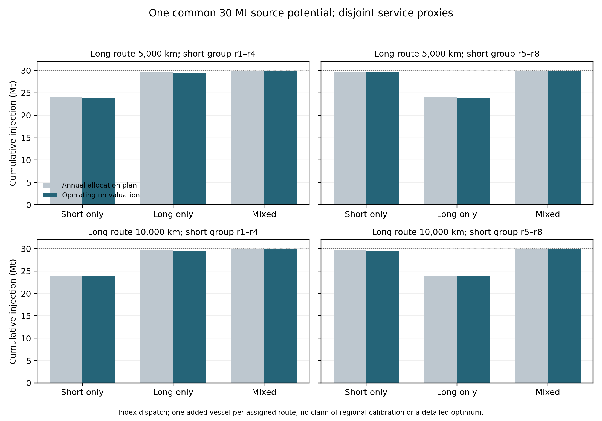
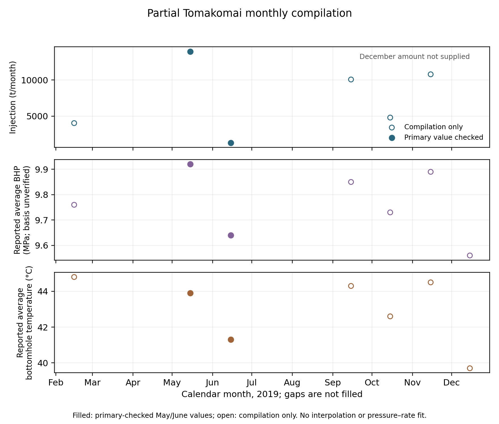

**Draft status.** B0–B3, a shared-source annual allocation benchmark, detailed fixed-plan operating reevaluation and three dispatch rules are implemented. Complete lifecycle net avoided GHG is not computed. All 92 unique supplied publications have targeted full-text review; extraction remains selective. Empirical inputs retain source locators, and model structures are declared separately. Annual allocation outputs are exogenous service proxies, not independently calibrated physical rate limits. The Japan–Malaysia–Australia application remains provisional. Three subsequently retained primary PDFs verify selected monthly and EXCOOL observations. A separate public intake now retains a pressure-constrained Norwegian reservoir model with paired simulation outputs and three European cement-capture heat/work inventories; neither is a calibrated regional input. Formation classification, monthly pressure reference, independent maximum-rate service and compatible utilities/conditioning remain unresolved. Author names, affiliations and journal formatting remain to be supplied.

# Abstract

Cross-border CO₂ storage can enable additional injection when local service is constrained, but shipping schedules and incomplete inventories can change the comparison. This study develops a source-traceable dynamic benchmark from 92 supplied publications, each reviewed in selected full-text passages. Four controlled variants combine static or annual service proxies with fixed-factor or event-based shipping, tracking capture curtailment, integer fleets, initial heel and uncredited closing inventory. Published inputs reproduce all 75 reported fleet cases; an independent pure-CO₂ equation-of-state calculation supports the selected table density under two explicit pressure interpretations. Annual fleet arithmetic nevertheless fails to establish operating feasibility. After fleet control, the conditional allowance for omitted differential burdens is +1.281 Mt at 5,000 km and −4.923 Mt at 10,000 km relative to a lower-service 1,000 km benchmark. A Norwegian electricity/NGCC reference and IMO-default fuel pathway reduce the 5,000 km margin to +8.69 kt; an optional published storage-component reference changes it to −4.44 kt. Japanese reporting-factor utility scenarios are negative. A separate annual mixed-integer model couples one 1 Mt/y source to disjoint reservoir groups. Twelve plans are reevaluated in 72 operating cases. Under one declared partition and fleet control, short-only, long-only and mixed operation inject 23.94, 29.53 and 29.87 Mt, respectively, from a common 30 Mt potential. Alternative dispatch rules materially affect some outcomes. These results test model structure and accounting sensitivity. They do not reproduce the original optimisations, establish an operational optimum, calibrate local maximum injection rates or complete a regional lifecycle comparison.

**Keywords:** geological CO₂ storage; source–sink matching; deliverability; shipping; lifecycle accounting; carbon break-even; reproducible research.

# 1. Introduction

The amount of CO₂ that can be stored in principle is different from the amount an industrial source can inject at a particular time. Reservoir pressure, well development, commissioning, temperature and water handling can restrict usable storage service even where a large prospective resource is reported. For domestic and foreign pathways, the relevant climate comparison therefore concerns the CO₂ retained and the additional greenhouse gas emissions incurred in enabling that retention. Storage resource or transport distance alone cannot resolve this comparison.

Regional screening illustrates the distinction. Zhang and Lau identify 391 Mt/y of stationary emissions within a 1,000 km radius of Singapore and mid storage resources of 0.5 Gt in oil reservoirs, 6.2 Gt in gas reservoirs and 379 Gt in saline aquifers. Arun is a named gas-condensate candidate with a reported 1.3 Gt resource. These estimates identify candidates; they do not supply annual injection service, a commercial allocation or a commissioning schedule [B4-08, p1]. National Malaysian power-sector analysis similarly provides decarbonisation context rather than a matched Japanese industrial-source inventory [B4-01, p1].

The relation between transport and storage characteristics is already established in infrastructure research. Wang et al. examine how distance, injectivity and capacity affect pipeline and sink selection. Nordic studies show that a longer shipping route to a reservoir with favourable injectivity can be economically attractive [B2-01, pp3–5; B3-39, p1; B3-33, p1]. An economic preference, however, does not itself demonstrate greater net climate mitigation. Capture curtailment, route emissions, additional wells and differences in the reference industrial service must also be considered.

Temporal infrastructure planning also has substantial prior coverage. Ooi et al. incorporate source and sink timing, injection rates and capacities using pinch analysis. Lee et al. combine capture retrofits, time-dependent constraints and compensatory power. Becattini et al. optimise yearly infrastructure rollout over a 25-year horizon, including overseas storage, a delayed hypothetical domestic sink and emissions relative to business as usual [B3-11, p1; B3-14, p1; B3-42, pp1–7,15–16]. Bertoni et al. incorporate reservoir physics in infrastructure optimisation [B2-04, pp1,9–10]. Consequently, neither a dynamic deployment model nor a common-reference emissions comparison should be claimed as the first contribution of Paper 1.

The newly supplied South Sumatra study further narrows the gap. Budiarto et al. combine reservoir availability, well-derived injection limits and multi-period source–sink optimisation. Their single- and multi-well configurations produce different cumulative storage outcomes [B4-06, pp8–10,16]. Gabrielli et al. also consider costs, emissions and the ability to store captured carbon under infrastructure failures, including domestic and foreign storage configurations [B4-07, p1]. Additional retention from better storage service is therefore an established mechanism rather than a novel premise.

Operational transport and lifecycle modelling are likewise well developed. Bjerketvedt et al. connect uncertain weather, vessel operation and buffers to transport completion and expected cost. Roussanaly et al. compare pressure, conditioning and ship design; Jeon et al. couple tank and cargo-handling dynamics to marine GHG intensity. Fraga et al. integrate a prospective post-capture inventory with multi-period cost/GHG optimisation, and Nöhl et al. evaluate cumulative carbon payback from changing transport infrastructure [B2-08, pp6–8; B3-38, pp7–9; B3-29, pp4–10; B2-12, pp5–18; B2-13, pp3–5]. More operational detail is thus a modelling choice whose decision value requires evaluation.

A narrower question remains useful: under a common industrial-production counterfactual, when does jointly resolving annual storage deliverability and operational shipping change the magnitude, sign or robustness of the difference between domestic and foreign mitigation? This question allows an unchanged ranking or small interaction. Kolster et al., for example, find limited long-horizon sensitivity to substantial multi-year injection-rate variation in the studied Bunter cases [B3-37, pp3–7]. A model-comparison study should retain such a null-effect benchmark.

This draft makes four present contributions. First, it creates a page-located evidence register that distinguishes observations, published model inputs, published outputs and calculations. Second, it implements a controlled four-variant service/shipping comparison with explicit mass balances, inventories, scheduling conventions and fleet-adequacy controls. Third, it quantifies source-based capture-utility and marine-fuel inventory sensitivities, identifying the remaining differential-burden allowance and the missing terms needed for full net avoided emissions. Fourth, it couples disjoint reservoir groups to one source in an annual mixed-integer benchmark and reevaluates the plans under detailed operating and dispatch controls. Supporting pressure, conditioning, buffer, BOG and fluid-property calculations audit parameter-transfer errors. Prior work already covers multimodal phased networks, compensatory power and proxy-to-physics reevaluation; those individual features are not novelty claims [B2-06, pp3–6; B3-09, pp6–9; B3-23, pp10–12]. The exact absence of this model-comparison question from all prior literature is not asserted by the supplied-library review.

# 2. Evidence and methods

## 2.1 Library, extraction and scope

The original literature corpus contains 93 PDF files representing 92 unique publications and 1,301 physical pages across the unique publications. The two supplied versions of the source–sink matching review B2-17/B3-46 are counted once as a publication and retained as separate files. Previously downloaded originals are reused for same-title reuploads; binary equivalence of every reupload has not been established. The retained PDFs and the supplementary DOCX, identified by SHA256, define the original literature evidence. A later reference-data intake contains 104 uploads, of which 100 were accessible and four exceeded the per-file transfer limit. It includes regulatory factors, NETL spreadsheets/reports, IMO guidance, Copernicus snapshots and IBDP materials, with separate coverage and evidence-type records. The DOCX belongs to B4-06 and is not counted as a new publication or PDF. A third intake contains 26 uploads, 25 accessible files and 1,186 indexed pages across 17 PDFs, including Tomakomai technical chapters and Northern Lights component inventories. These pages are not claimed as exhaustively reviewed. A fourth intake has two compilation files, six workbook sheets and 60 located numeric claims, including duplicate/context values. It is separate from the 92-publication corpus. A subsequent intake adds a secondary ZIP memo and three primary PDFs, totalling 46 indexed pages. Targeted text/table and visual checking now verifies three of those nine linked sources; the other six remain unverified. A separate register has 100 located primary quantities, with native and visual-table modes distinguished. The registers overlap rather than forming independent observations.

The initial extraction covered 48 unique publications. Follow-up review now covers selected methods/results passages in the other 44, giving 92 unique publications with targeted full-text review and none at abstract-only stage. Manual reading cards identify reviewed pages, methods, findings and transfer limits; automated navigation packets do not constitute review. A separate register adds 140 located numeric records: two are selected for a named MEA utility reference, 16 for within-source benchmark arithmetic, and 122 remain context or HOLD. This is a purposive supplied-library synthesis rather than an exhaustive systematic review. The original ledger retains 1,642 records, including ranges and grouped cases; the new registers overlap source information and are not added as independent observations. This number is not a count of independent observations. The Google Drive folder and oversized planetary-limit ZIP were not ingested; the standalone planetary-limit PDF is included. No uninspected contents are represented as evidence.

A separate curated PDF table records 250 atomic quantities, their original units, physical page/table, scenario, evidence type, inventory boundary and transfer limits. A 134-row subset enters the present analysis: 59 quantities support 49 calculations, and 75 entries preserve the published large-ship fleet table. An additional 352 numeric supplementary records comprise 102 native-table entries and 250 one-decimal annual allocation annotations. The full 720-cell figure grid preserves its 470 blanks separately. The annual reconstruction uses these supplementary tables and annotations in a dedicated pipeline. A dedicated 30-row operational-parameter register additionally locates every shipping/fuel/design quantity used by the new model; these quantities overlap the ledger and are not independent observations. The broad extraction ledger is not a ready-to-run harmonised input file. Values marked HOLD and context-only quantities cannot enter the calculation script. The source audit records 59 consequential interpretation issues; an issue can remain open where the affected data are excluded from the calculation.

The calculations preserve original denominators. Unit conversions and algebraic definitions are distinguished from empirical inputs. Published minima and maxima are not treated as probability distributions. No cost factor is converted into GHG, no national resource is assigned as a source's annual allocation, and no missing graph scale is filled with an assumed value. Reported numbers retain their source precision even where machine-readable outputs carry additional computational decimals.

## 2.2 Selecting source and sink evidence

The intended Japan–Malaysia–Australia application is screened against the data required for an implementable model, rather than treated as a fixed set of available services. Higashi-Niigata is a named Japanese candidate with history-matched reservoir forecasts. Its pressure-relief case reports approximately 25–30% greater injection volume, but the supplied figures do not provide recoverable numerical vertical scales for complete absolute annual mass series [B1-07, pp6–9]. Assigning an arbitrary Mt/y scale would therefore be unsupported.

Malaysian Field X studies provide pressure constraints and thermal mechanisms but are anonymised; the studies cannot be assumed to describe one contracted storage service [B1-09, p13; B1-11, pp5–6]. The South-West Hub model supplies an Australian conceptual reference while excluding thermal stresses, so it cannot simply be combined with Malaysian thermal limits as a calibrated Australian sink [B1-12, pp18,21–22]. Regional resources and historical governance assessments do not establish present storage access.

The user authorised explicitly disclosed geographic proxies when local data are unavailable. The present numerical draft therefore selects the internally coherent South Sumatra single- versus multi-well outcomes as the storage-service benchmark. Published Norwegian post-capture GHG outcomes are retained only in the supporting accounting audit in Appendix A. The main operational results use explicit component inventories. These substitutions test accounting sensitivity; they do not make Indonesian geology Japanese, or Norwegian energy factors applicable to an Asian route. No African dataset is introduced merely because a geographic proxy is permitted.

| Required component | Evidence selected | Role | Remaining transfer limit |
|---|---|---|---|
| Common source–sink storage comparison | Budiarto B4-06, p16 | Published lower/higher cumulative storage | Indonesian industrial system; annual allocation figures now supplied, but exact physical rate-constraint arrays remain unavailable |
| Supporting accounting audit | Fraga B2-12, pp18,20 | Appendix A diagnostic only | Different country/network portfolios; includes fugitives |
| Feed/pressure conditioning | Roussanaly B3-38, p7 Table 3 | Within-feed process comparison | Different inlet states cannot be pooled as one uncertainty range |
| Thermal pressure constraint | Tan B1-11, pp5–6 Tables 2–3 | Within-seal pressure sensitivity | Analytical field-specific ceiling, not an annual rate factor |
| Buffer and transport completion | Bjerketvedt B2-08, pp7–8 | Denominator and completion benchmark | Original route/weather assumptions |
| BOG process emissions | Jeong B1-19, p7 Table 6; p13 Table A6 | Partial-process intensity | Excludes full propulsion/upstream chain |
| Large-ship fleet counts | Noh and Kang B4-09, p6 Table 7 | All 75 reconstructed with explicitly selected Table 1 density | Conflicting prose excluded; pure-fluid EOS check does not validate actual cargo |

The later Tomakomai reports provide a Japanese historical benchmark:45 monthly table records,17 shut-in/test records and nine fall-off interpretations [D7-20, p3; D7-22, pp10–11; D7-18, p10]. The project stopped injection in November2019 and remained in monitoring in the supplied2026 newsletters [D7-25, p1]. Its data improve local evidence without establishing current contracted storage. A prospective pressure-constrained Case2 is retained under its original hypothetical restart, completion and plume constraints; reported capacity labels are not converted into annual maximum-rate arrays.

## 2.3 Published-case calculations

The thermal benchmark compares the same seal under isothermal conditions and estimated cooling. For each seal, the pressure-ceiling reduction is the printed isothermal ceiling minus the printed cooled ceiling, divided by the former when expressed as a percentage. This percentage describes the stated pressure ceiling, not pressure headroom above initial reservoir pressure, and not an injection-rate reduction. Original psi labels are retained because pressure datums are not sufficiently clear to justify further conversion [B1-11, pp5–6].

Conditioning comparisons use four electricity requirements from the same source table: pure feed and pressurised inland feed, each at 7 and 15 barg. Differences are calculated within each feed case; pure-to-inland ratios are descriptive comparisons of different inlet conditions [B3-38, p7 Table 3]. No electricity emission factor is applied to this within-feed conditioning benchmark because its actual regional/year supply is unselected; the separate reference-inventory scenarios do not establish that supply.

Buffer ratios divide the reported buffer by the 5,000 t ship capacity. The 99% and 100% transport-completion cases are kept separate. The paper's use of average-cycle captured mass as another denominator is not relabelled as ship capacity [B2-08, pp7–8].

For the BOG benchmark, annual purge-plus-auxiliary-generation CO₂ from Table 6 is divided by transported mass from Table A6 for the same process and impurity case. Emissions are in t/y and mass in thousands of t/y; the resulting numerical ratio is kgCO₂/t transported. These are partial-process CO₂ intensities. They are neither full lifecycle CO₂e factors nor fractions of cargo necessarily lost to atmosphere [B1-19, pp7,13].

The large-ship source prints 1,154 kg/m³ in Table 1 and 1.1546 kg/m³ in the fleet-method prose. The operational scenario explicitly selects Table 1: together with the other printed inputs it reproduces all 75 fleet counts in Table 7. The inconsistent prose is not repaired or used. This reproduces the declared Table 1 arithmetic. The independent pure-fluid equation-of-state check in Section 2.10 additionally tests physical consistency without repairing the prose or replacing the selected density [B4-09, pp3,5–6].

The Budiarto supplement adds three native tables and ten embedded figures [B4-06-S1]. Tables S1–S3 are extracted directly from DOCX cells; no OCR is needed for their 102 numeric entries. Figures S8–S10 provide annual MILP allocation heatmaps for 2027–2056. All 250 printed one-decimal annotations are transcribed with reservoir/year and image-cell locators. The 470 blank cells retain a distinct status. For reconstruction, totals sum the printed allocations, interpreting a blank as no reported allocation rather than a measured physical zero. Automated cell-occupancy and approximate colour checks support visual annotation review; colour-derived precision is not used in calculations.

The annotated heatmaps are outputs mr,t selected by the original optimisation, whereas the main paper's kr,t denotes the physical annual injection upper bound [B4-06, p9]. Substituting the former for the latter would predetermine aspects of the reconstructed solution. The present annual replay therefore checks the published outputs, readiness dates and cumulative totals; it does not reproduce the original MILP or independently identify a feasible maximum service profile. Figures S1–S7 relate pressure to rate/storage efficiency and are retained without claiming that they supply a complete numerical calendar-time constraint array.

The display-resolution audit assumes conventional rounding to the nearest 0.1 Mt/y. For n annotated cells, the conditional sum envelope is the printed sum ±0.05n Mt over one-year bins. This is a bound derived from the printed precision, conditional on the rounding convention and blank interpretation, rather than a confidence interval. Values are not scaled to force agreement with the main paper. Rounded annual sums can slightly exceed the nominal source rate; that alone is not evidence of physical excess injection.

## 2.4 Mitigation accounting

For an actual pathway s under common industrial production, net avoided GHG is defined by an explicit no-CCS counterfactual:

$$A_s=\sum_t(E_{0,t}-E_{s,t}). \tag{1}$$

Under a fossil-source counterfactual where each retained tonne displaces one emitted tonne and all additional burdens are consistently counted, this can be reconciled as retained source CO₂ minus additional lifecycle GHG. Captured-source CO₂ vented or leaked must reduce retained mass; it must not also be subtracted as the same source loss within additional GHG. Upstream fuel methane and other incremental emissions remain additional burdens. Biogenic sources, direct air capture, displacement and co-products require their own counterfactual treatment.

The primary numerical comparisons use our common-source operating model and explicitly named component inventories. The earlier cross-pairing of independently optimised published storage/GHG outcomes is retained as a supporting diagnostic in Appendix A. It does not establish a full mitigation result or reproduce either original optimiser.

## 2.5 Reproducibility and checks

Every calculation output records its input IDs, formula, unit and boundary. The repository validates retained PDF hashes, page-text counts, numeric source-token locators and calculation eligibility; these checks establish file identity and traceability rather than the scientific validity of a paper's model. Table mapping for the selected datasets is checked against the retained source pages. The analysis has no fitted reservoir parameters, random draws or fabricated annual injection series. The operational model adds explicitly declared fleet, berth, availability-window and dispatch structures; these are model design conventions, not observed local data. Tests check the threshold identity, unit scaling, zero-difference reference case, HOLD exclusion and provenance closure. Figures are generated from the same registered inputs/results.

## 2.6 Implemented operational proxy model

The present numerical extension uses the original thirty nominal 8,760-hour bins labelled 2027–2056 and a constant 5.327 Mt/y study-defined source flow. Actual Gregorian leap-year timing is not asserted. The lower/higher-service alternatives use SW-A/MW-A allocation sums as exogenous annual envelopes. Two static controls are derived from the same values: a constant whole-horizon mean and reservoir-specific post-readiness means. Each preserves the nominal cumulative rounded allocation total before applying the common source/transport constraints. These transformations do not establish independent physical injection limits.

B0/B1 use a fixed ship-fuel factor calibrated at full source flow, including the integer last voyage. B2/B3 use continuous-time events for loading, outbound movement, unloading and return. Cargo is assigned at loading start and received at unloading end. One loading berth and one receiving berth are declared structures. Published vessel volumes, fuel rates, port durations, speed, fill/heel fractions, terminal size and operating hours are used [B4-09, pp3,5–7]. The marine initial heel is charged from captured source CO₂; captured mass equals injected mass plus export, import and marine inventories. Source capture is curtailed at export-buffer capacity. Endpoint stocks are not credited as injected or permanently retained.

Published 8,000-hour annual availability is placed either in evenly staggered vessel windows or synchronised windows. Each active phase must finish within its window; a full nominal round trip must fit when loading begins. This is a conservative deterministic dispatch convention, not an observed weather calendar or an optimal schedule. Within each annual bin, capture potential and the proxy injection rate are constant. Injection cannot exceed available import inventory. Waiting fuel, actual BOG behaviour and leakage processes lack compatible inputs and are not simulated as measured quantities.

The reference fleet uses the source's integer annual-capacity formula. That design is held fixed through the thirty bins and checked in the detailed model. Equal-injection controls rerun both paths at the smaller baseline injected quantity, retaining uncredited residual inventory. An added-vessel control perturbs each fleet by one vessel. A restricted design search then selects the minimum added fleet beyond the reference reaching 99% of the continuous, no-inventory service reference. The percentage is transferred from a published transport-completion criterion [B2-08, p7], with its changed denominator explicitly declared; it is not a reliability probability or a cost-optimal fleet.

The directly inventoried component is active-cycle fuel-combustion CO₂. A published 3.206 tCO₂/t MGO factor is transferred to the source's MDO fuel-rate scenario [B1-19, p4; B4-09, pp5,7]. This does not provide upstream/non-CO₂ fuel GHG or idle/hotel fuel. An optional separate scenario applies published compressor nameplate power for 8,000 h/y with a published generator SFOC of 197.5 g/kWh; it is a costing-duty envelope, not a prediction of actual BOG load. The source's ambiguously LHV-labelled 0.084 kg/kWh value is not used.

Let U contain all uninventoried differential burdens, including any retention reconciliation needed when injected mass is used as a source-carbon proxy. The implemented climate-related output is:

$$H=\Delta R_{\mathrm{injected}}-\Delta G_{\mathrm{ship,CO2}},\qquad \Delta A=H-\Delta U. \tag{7}$$

The second equality is conditional on a compatible fossil-source counterfactual and consistent retention/loss treatment. A positive full advantage requires ΔU < H; ΔU is not assigned zero. Negative H alone cannot prove a full disadvantage if omitted differential terms favour that pathway. The complete net-avoided-GHG output remains empty. The earlier Fraga reported-burden score is retained as a supporting accounting audit and is not a parameter in this operational model.

The grid contains three source vessel sizes, five published higher-service distances, two static proxy definitions and the four variants. Additional calendar and rounding cases produce 144 comparisons and 36 contrasts. The two-factor interaction is calculated separately from the full B3-minus-B0 contrast. No geographic service availability, calibrated reservoir physics, mixed-network optimum or complete lifecycle inventory is inferred from this exercise.

## 2.7 Reference utility and marine-inventory extension

The supplied NETL workbooks are NGCC and PC capture-retrofit databases, not the industrial model. Their reference cases use CANSOLV at different capture fractions and host conditions [D5-48; D5-50]. Cached reference parameters are read without executing macros, recalculating user cases or refreshing external links. Six reference cases normalise additional auxiliary electric load and steam-turbine opportunity loss against the published captured-CO₂ flow. The resulting electric make-up route represents external replacement of both output penalties under a matched-output accounting scenario. It is not an auxiliary electricity measurement alone.

A mutually exclusive PC heat-plus-auxiliary route uses the paired report's reboiler, reclaimer and dryer steam/condensate streams and its incremental auxiliary power [D5-49, physical pp41,43–44,46–51]. Net reported steam-utility enthalpy import is derived as the sum of incoming minus outgoing utility enthalpy flows per reported tonne of CO₂ product. It is not claimed as a verbatim isolated reboiler-duty measurement, and minor-stream/rounding/product-composition qualifications remain. Steam-turbine derate is not added to this route. The reference capture/compression boundary includes dense-phase compression; another unharmonised compression or liquefaction penalty is not added. These are uniform engineering transfers, not measured energy demands for the fourteen Indonesian processes or a Japanese facility. Capture fractions identify reference designs and are not applied again to already captured source mass.

The utility scenarios preserve accounting scope. The Norwegian 2025 climate-disclosure factor is 9.4 gCO₂e/kWh, while its market-disclosure factor is 430.93 gCO₂/kWh; they are separate cases [D5-02]. The original sales workbook has an incorrect declared used range; native XML recovers 101.0025 TWh without and 36.5945 TWh with guarantees of origin, which are volumes rather than emission factors [D5-01]. Japanese R8 fallback factors are 0.000416 tCO₂/kWh for electricity and 0.0532 tCO₂/GJ for heat [D5-38; D5-16]. These are reporting coefficients with header-specific performance/emissions/reporting years, not identified supplier contracts, compatible industrial-steam supplies or future forecasts. Supplier/menu base and adjusted factors remain separate; gas factors in tCO₂/1000m³ are not converted to delivered heat without a calorific basis and conversion efficiency. No full lifecycle or harmonised characterisation boundary is inferred from those workbooks alone.

The selected fossil MDO/MGO ULSFO pathway in the 2024 IMO guideline supplies WtT 17.7 gCO₂e/MJ, LCV 0.0427 MJ/g, and CO₂/CH₄/N₂O coefficients of 3.206/0.00005/0.00018 g/g fuel [D5-54, physical p51, Appendix2 row5]. With the guideline's GWP100 values of 28 and 265 [p5], the default WtW factor is 4.01089 kgCO₂e/kg fuel. No LNG-specific slip factor is imported. The pathway is a default scenario, not certified actual bunker fuel or an idle/process fuel inventory.

The extension applies twenty utility scenarios to the 144 original paired results and five design-controlled route cases, giving 2,980 component-inventory comparisons. Capture utilities are charged to captured mass, including uncredited endpoint material, while source-carbon benefit remains conditional on injected mass and retention reconciliation. The initial operating model is unchanged. Remaining process, utility-scope, idle/terminal, injection/asset and retention terms remain in the unquantified differential burden.

The new data do not establish weather calendars or calibrated physical service. Each of the two NetCDF subsets has one timestamp and one point, so no annual weather-frequency estimate is made. The IBDP seismic catalogues are not CO₂ flow/pressure series. A 2012 Illinois study provides independent St.Peter/Knox-Potosi simulation reference values, including first/last/average St.Peter rates of 0.660/1.164/0.990 Mt/y at a 1,980 psia cap over twenty years [D6-22, pp14–15,20–22]. These are not observed Mt.Simon injection limits or a full annual constraint array. The four unavailable reports and partial BagIt validation are recorded explicitly.

## 2.8 Japanese historical and component-inventory checks

The rotated Tomakomai table is extracted from native PDF word coordinates, preserving180 monthly/cumulative cells, their original precision and eight fiscal cells [D7-20, p3]. Reported zeros, monthly/fiscal discrepancies and formation-specific totals remain distinct. Selected shut-in windows include measurement times, prior average rates and causes; an ongoing final test has no zero-imputed endpoint [D7-22, pp10–11]. Neither achieved throughput nor test-derived effective permeability is interpreted as an independent maximum injection limit.

A hydrostatic reference calculation evaluates pressure-datum sensitivity:

$$\Delta P=(\rho_{\mathrm{high}}-\rho_{\mathrm{low}})g_0\Delta z. \tag{8}$$

The source gives density470–670kg/m³ and52m vertical separation between sensor and completion [D7-22, p12]. Standard gravity9.80665m/s² is a declared reference constant. This calculation checks the stated scale of depth correction; it does not fit a reservoir pressure history or establish a safe injection rate.

The Northern Lights prospective report supplies separate numeric transport/storage components, with blank activity cells preserved as unknown [D7-15, pp12–13]. To avoid overlapping existing ship-fuel accounting and unresolved captured-source fugitives, an optional sensitivity transfers only printed storage rows excluding `Other process emissions`, normalised by that study's127.8Mt stored. Scaling an average lifetime burden by additional stored mass is explicitly a reference sensitivity rather than a marginal asset model. Customer capture/liquefaction, GWP/phase inconsistencies and missing activities are not closed by this transfer.

Japanese company/facility exports are retained as screening evidence [D7-03; D7-04; D7-06]. Total reported GHG is not capture supply. The additional-information file's ENEOS references conflict with Nippon Steel metadata, so those records are not joined [D7-01]. Report-year and emissions-year labels remain separate. The supplied CPPI annex is container-port context, not a CO₂-terminal schedule [D7-07]; EXCOOL specifications do not provide an international fuel/availability curve [D7-10].

## 2.9 Shared-source allocation and dispatch checks

A separate annual mixed-integer benchmark uses the published 1 Mt/y transport flow class [B4-09, pp3,6], over the same 30 nominal bins: 30 Mt of common potential, not a measured Japanese plant. The eight MW-A reservoirs are partitioned into disjoint groups r1–r4 and r5–r8. Each group serves one route, and a swapped assignment is a structural control. SW-A and MW-A share reservoirs and are never added as independent sinks. Short/long distances are the published 1,000/5,000 or 1,000/10,000 km scenarios, not measured national routes.

For allocation x in tonnes and integer annual voyages z, the objective is the named partial component score:

$$\max\ \sum_{r,t}x_{r,t}(1-u/1000)-\frac{g}{1000}\sum_{a,t}f_a z_{a,t}. \tag{9}$$

Here u is the NETL NGCC90/NVE-2025-climate utility reference in kg/t captured; g is the IMO-default fuel factor in kgCO₂e/kg fuel; and f is active-cycle kg fuel/voyage. The annual approximation equates planned capture and injection. It constrains total annual allocation to 1 Mt, each reservoir to its reported resource/readiness and exogenous MW-A allocation envelope, and each route to cargo per voyage times integer voyages. Voyage counts cannot exceed the reference fleet times the floor of available hours divided by cycle duration. These are explicit surrogate service bounds; blank annotations imply no reported service in this benchmark rather than geological zero capacity. All source and reservoir constraints are coupled in one solve. Short-only, long-only and mixed modes, two partitions and two distances give 12 annual plans, solved with SciPy/HiGHS at a requested zero relative MIP gap. A complete lifecycle objective is unavailable.

Each fixed annual plan is then reevaluated using the operating model, three dispatch rules and either the reference fleet or one added vessel per assigned route: 72 cases. The two routes have dedicated export tanks/loading berths and receiving terminals. Their scheduled source shares sum to at most the common potential at every time; unused shares are not adaptively reassigned. Actual capture, injection, inventory and fuel replace the annual approximations. This is a conservative fixed-plan reevaluation, not detailed reoptimisation or proof of a globally best operating plan. Asset/idle burdens of assigned vessels remain missing, including any inactive route fleet.

The dispatch rules choose an eligible vessel by index, earliest availability-window end, or least accumulated active hours. Eighteen additional controls apply all three rules to the six original selected-fleet cases, preserving source, fleets, service and calendars. These are feasibility and algorithm-sensitivity checks; no observed operator schedule is available to validate them. Multimodal integer planning and model-to-model reevaluation are established approaches [B2-06, pp3–6; B3-23, pp10–12].

## 2.10 Independent component and within-source benchmarks

The selected ship density is checked with the published pure-CO₂ Span–Wagner equation of state, implemented in CoolProp 8.0.0 [EOS]. At the source temperature of −50°C, two reference interpretations retain the unresolved pressure datum: 700 kPa absolute, or 700 kPa gauge plus the defined standard atmosphere of 101.325 kPa. These are reference calculations, not measured local pressure or mixture properties. All 75 fleet cases are recomputed as a sensitivity while the original table density remains unchanged.

Three within-source checks avoid cross-pairing optimised studies: compensated-power intensity in Chong et al.; pressure-constrained rates across five Cihan et al. reservoir realisations; and proxy versus full-physics well-placement gains in Musayev et al. [B3-09, pp6–9; B3-16, p9; B3-23, p12]. Original volumetric units are retained where a reference-state density is unavailable.

A further utility reference replaces NETL with the same-paper MEA demand of 3.6 GJ/t captured and 0.1 MWh/t captured in Beiron et al. [B2-11, pp3–4]. The electricity boundary already includes absorption, compression and liquefaction. No extra liquefaction or district-heating credit is added. Japan's separate heat/electricity reporting fallbacks produce an accounting sensitivity; actual compatibility with the paper's 120°C/3 bar steam and an industrial plant remains unverified. Heat/electricity pairs are transferred together rather than assembled from unrelated process cases.

## 2.11 Primary-source follow-up to the partial compilation

Two supplied compilation files contain six Tomakomai monthly mass/average-pressure/average-temperature pairs and one pressure/temperature-only record [D8-01; D8-02]. The subsequent uploads retain the ClassNK article and the reports named June and July 2019 [D9-02; D9-03; D9-04]. Selected native tables/text and rendered pages are checked independently of the accompanying ZIP's assertions [D9-01]. The current register verifies 33 of the 60 compilation claims as printed primary values and reproduces two as primary-input calculations; 25 remain pending. This upgrades provenance, not eligibility as calibrated physical inputs. Other URLs described as inspected in the ZIP are not promoted without local primary evidence.

ClassNK Table 3 is extracted from its actual cell geometry and visually checked, preserving seven distinct trials, printed precision, MPaG units and the after-loading footnote [D9-02, p5]. Table 2 is raster and its selected design quantities are explicitly recorded as visual transcriptions. The article's voyage case additionally supplies approximate elapsed times, cargo-state endpoints and reported rise rates; these are tested within that same source [D9-02, pp4–7]. The 100-record register is targeted rather than an exhaustive inventory of the three PDFs.

For Tomakomai, report issue, monthly table period and current header date are distinct. The June issue's table describes May, while its overall header is dated 29 June. The July issue's table describes June, while its header is dated 30 July [D9-04, p12; D9-03, p12]. Monthly tables and five wells' pressure/temperature means are extracted separately. The Moebetsu averages are at a printed depth of 930 m; the pressure unit is MPa with gauge/absolute basis unspecified [D9-03; D9-04, pp17–18]. That depth is not silently equated to the later 921 mTVDSS sensor or 973 mTVDSS completion. No pressure-cap comparison, native telemetry or maximum-rate calibration is inferred.

Cumulative differences retain their formation labels and dates. The conditional mixed-classification explanation is tested arithmetically without correcting May's source value. Remaining sparse months and missing December mass stay unfilled. For EXCOOL, a separate pure-fluid EOS reference uses the now-verified MPaG values plus standard atmosphere. A conditional nearest-displayed-unit sensitivity uses ±0.05°C and ±0.005 MPaG from Table 3's precision; these are not measured uncertainties. Neither loading trials nor one reported voyage supply a fuel curve, future constant BOG law, maintenance calendar or whole-chain emissions inventory.

## 2.12 Public pressure-constrained reservoir and capture inventories

A subsequent public-source search used Firecrawl to locate the Johansen study and CEMCAP report. After Firecrawl reported insufficient credits, direct HTTPS retrieved the official Norwegian Offshore Directorate Bjarmeland archive and the native CEMCAP PDF. URLs, retrieval routes, dates, upstream archive hash and retained-member hashes are recorded separately from the supplied-publication corpus [PUB-BJARMELAND; PUB-CEMCAP]. Unverified parser-generated figure tables from the Johansen response are excluded. The MRST VE/atlas pressure example is a different model and is not mixed into the selected compositional deck.

For Bjarmeland case CO2_BJ_C07B9, the retained input set resolves all three explicit grid INCLUDE files and contains rock/EOS/relative-permeability/initial/well-control inputs. Native summary columns provide paired time, standard-volume injection rate/cumulative, field pressure, injector BHP and producer rates. Column identity includes well name, unit and source line. The native BARSA pressure basis is retained. These source simulation results are not independently rerun or converted to annual maximum mass service [PUB-BJARMELAND, WCONINJE and native RSM].

CEMCAP Table 5.3 is extracted by native cell geometry and checked against rendered physical pages 22–23 (printed 16–17). Forty-two values describe three paired capture cases, including heat, capture auxiliaries, compression work, cooling, steam quality, product conditions and solvent makeup. MJ/kg is converted exactly to GJ/t or kWh/t. Total work already includes compression; no duplicate compressor/liquefier or turbine-derate term is added. Upstream pretreatment, cooling-system power, actual suppliers and conversion of the 110 bar product to ship cargo remain outside the verified pair. Completeness refers to reported capture heat/work, not a full facility or lifecycle inventory [PUB-CEMCAP, §5.2 and Table 5.3].

# 3. Results

## 3.1 Published storage improvement is not a complete mitigation gain

The South Sumatra model reports 153.21 Mt stored for SW-A and 159.81 Mt for the multi-well cases. Their difference is **6.60 Mt**, or **4.31%** relative to SW-A. The study attributes the lower single-well storage to early injection-capacity limitations; this is a coherent published example of storage deliverability affecting cumulative capture/storage outcomes [B4-06, p16]. It is a simulated design result, not a measured field response.

The paper reports costs around USD17.53 billion for SW-A and around USD18 billion for the multi-well cases, with capture dominating chain cost [B4-06, p16]. Those economic values cannot supply the GHG of additional wells or pressure management. The two cumulative outcomes alone do not determine an annual injection profile; the now-supplied supplementary heatmaps provide a rounded allocation reconstruction. The increase establishes the magnitude of a published gross-storage effect and the associated data need; it does not establish a 6.60 Mt net GHG benefit or a Japanese domestic/export difference.

Tables S1–S3 establish a more complete common-source benchmark. Fourteen source rates sum to **5.327 Mt/y**, giving **159.81 Mt** across the original 30 annual bins, exactly matching the reported multi-well cumulative total. Eight candidate reservoirs have a summed model resource of **537.4 Mt**, with estimated start years from 2027 to 2039, and the network table provides 46 numeric hub distances. The resource sum is not an annual injection capacity or proof of available commercial storage. Source capture costs are not converted into capture GHG.

| Quantity | Published-table aggregation | Locator |
|---|---|---|
| Sources | 14 | Table S1 |
| Annual source-rate sum | 5.327 Mt/year | Table S1 |
| Source CO2 over 30 calendar-year bins | 159.81 Mt | Table S1; 2027–2056 horizon |
| Candidate reservoirs | 8 | Table S2 |
| Summed candidate reservoir resource | 537.4 Mt | Table S2 |
| Numeric hub distances | 46 | Table S3 |

Replaying the printed annual cells gives the following cumulative totals. Differences from the main paper are preserved. Each reported main-paper total lies within the conditional worst-case envelope implied by its one-decimal annotations; this establishes compatibility with rounding, not exact reproduction. No annotated injection occurs before the corresponding Table S2 estimated readiness year.

| Scenario | Printed cells | Sum of printed allocations (Mt) | Main-paper total (Mt) | Printed minus main (Mt) |
|---|---|---|---|---|
| SW-A | 100 | 152.8 | 153.21 | -0.41 |
| MW-A | 76 | 159.4 | 159.81 | -0.41 |
| MW-D | 74 | 159.5 | 159.81 | -0.31 |

The main paper defines source mass ms,t as captured CO₂ in its network mass balance [B4-06, p9]. Applying the stated capture-efficiency target again to Table S1's study-defined flow would change that quantity without support. A separate capture-energy and emissions inventory remains necessary for whole-chain accounting.

## 3.2 Operational results and design controls

Tabled results below use the 40,000 m³ design, aggregate-mean static control and staggered availability convention. They are model calculations from located inputs and declared structures. The raw reference-fleet B3 result at 10,000 km gives a positive allowance even where B0 is negative. The contrast cannot be attributed solely to geology: fleet/availability constraints also reduce the lower-service route's realised injection.

| Higher route (km) | Variant | Lower injected (Mt) | Higher injected (Mt) | Additional active ship CO₂ (Mt) | Uninventoried allowance (Mt) |
|---|---|---|---|---|---|
| 5000 | B0 | 152.800 | 159.400 | 5.030 | +1.570 |
| 5000 | B1 | 152.508 | 159.108 | 5.021 | +1.579 |
| 5000 | B2 | 142.886 | 159.212 | 5.114 | +11.212 |
| 5000 | B3 | 142.309 | 158.934 | 5.110 | +11.514 |
| 10000 | B0 | 152.800 | 159.400 | 11.212 | -4.612 |
| 10000 | B1 | 152.508 | 159.108 | 11.192 | -4.592 |
| 10000 | B2 | 142.886 | 155.657 | 10.954 | +1.817 |
| 10000 | B3 | 142.309 | 155.743 | 10.969 | +2.466 |

For the lower-service 1,000 km proxy, the annual source-model formula gives two ships. The detailed simulation reaches about 93.3% of the continuous no-inventory reference under the selected window/berth/buffer conventions. The restricted 99%-of-reference design control therefore selects three. The higher-service 10,000 km case similarly changes from thirteen to fourteen vessels. These are model-dependent design decisions, not evidence that actual ports require those fleets.

| Service proxy | Route (km) | Reference fleet | Selected fleet | Initial/reference injection (%) | 99% target met |
|---|---|---|---|---|---|
| SW-A | 1000 | 2 | 3 | 93.3 | True |
| MW-A | 1000 | 2 | 3 | 93.1 | True |
| MW-A | 5000 | 7 | 7 | 99.9 | True |
| MW-A | 10000 | 13 | 14 | 97.9 | True |
| MW-A | 15000 | 18 | 21 | 93.0 | True |
| MW-A | 20000 | 25 | 25 | 99.3 | True |

With that design control, the higher-minus-lower conditional allowance is approximately +1.281 Mt at 5,000 km and −4.923 Mt at 10,000 km. A full climate interpretation requires the unknown ΔU in Equation (7), including extra capture, upstream fuel, terminals, injection/assets and retention. No universal break-even distance is identified between these two scenario points.

The equal-injection control gives no additional injected benefit and additional ship-combustion penalties of approximately 4.385 and 9.865 Mt at 5,000 and 10,000 km. The one-added-vessel control changes the sign of the raw 10,000 km comparison. At 5,000 km, synchronising instead of staggering the same published availability duration changes the raw B3 allowance from about +11.514 to −2.625 Mt. Calendar placement is unsupported by local observations, so these are structural sensitivities rather than probabilities or preferred forecasts.

| Control | Higher route (km) | Added vessels per route | Additional injection (Mt) | Additional active ship CO₂ (Mt) | Uninventoried allowance (Mt) |
|---|---|---|---|---|---|
| one-vessel structural control | 5000 | 0 | 16.625 | 5.110 | +11.514 |
| one-vessel structural control | 5000 | 1 | 6.308 | 4.980 | +1.328 |
| equal-injection control | 5000 | 0 | 0.000 | 4.385 | -4.385 |
| one-vessel structural control | 10000 | 0 | 13.434 | 10.969 | +2.466 |
| one-vessel structural control | 10000 | 1 | 6.168 | 11.091 | -4.923 |
| equal-injection control | 10000 | 0 | 0.000 | 9.865 | -9.865 |

For the reference fleet and aggregate-mean proxy, the full B3-minus-B0 allowance contrast at 5,000 km is about 9.945 Mt, while the two-factor interaction is about 0.293 Mt. At 10,000 km the corresponding values are 7.078 and 0.629 Mt. The full representation contrast is therefore not interchangeable with an interaction or a realised climate benefit. Re-evaluating fleet adequacy and omitted inventories is necessary before selecting a pathway.

## 3.3 Thermal and conditioning benchmarks

The four paired thermal cases show pressure-ceiling reductions of 521–525 psi, corresponding to 14.13–24.20% of their respective isothermal ceilings. The similar absolute changes produce different percentages because the starting ceilings differ. Transferring one percentage to another reservoir's injection rate would therefore lose both the physical quantity and the field context.

| Seal | Isothermal ceiling (psi) | Cooled ceiling (psi) | Drop (psi) | Drop (%) |
|---|---|---|---|---|
| A | 2,153 | 1,632 | 521 | 24.20 |
| B | 2,731 | 2,209 | 522 | 19.11 |
| C | 3,264 | 2,739 | 525 | 16.08 |
| D | 3,701 | 3,178 | 523 | 14.13 |

For pure feed, the 7/15 barg conditioning requirements are 96.3/90.4 kWh/t. For the pressurised inland-feed cases they are 17.4/9.0 kWh/t [B3-38, p7 Table 3]. The calculated within-feed differences are 5.9 and 8.4 kWh/t, respectively. Expressed relative to the 7 barg value, these are 6.13% and 48.28%. The pure-to-inland ratios at the same shipping pressure are 5.53 and 10.04. These comparisons show why a pressure choice cannot be evaluated without its inlet boundary; they do not show a universal shipping-energy saving.

## 3.4 Buffer, process-emissions and fleet benchmarks

The 99% transport-completion buffer of 5,120 t is **102.4%** of the 5,000 t ship capacity. The 100% completion buffer of 5,890 t is **117.8%** of ship capacity [B2-08, pp7–8]. An approximately 118% figure in the 99% case refers instead to average-cycle captured mass. A percentage without its denominator and completion requirement is therefore not a transferable design parameter.

The terminal literature reinforces this dependence on design and operating conditions. Seo et al. find an optimal temporary tank volume equal to the 11,801 m³ ship volume for their Korean case, which excludes unforeseen well/reservoir malfunctions [B4-02, pp3,8]. Zahid et al. model terminal loading, holding, unloading and emergency shutdown, including vapor return and BOG recycling [B4-03, pp1,3,9]. These results cannot be combined into a universal tank-to-ship ratio or a Japanese weather distribution.

Across the 18 paired Jeong cases, calculated purge-plus-auxiliary-generation intensity spans **1.27–21.25 kgCO₂/t transported**. The variation reflects different pressure/process and nitrogen cases, not repeated observations of one chain. The complete case matrix is provided below to preserve the pairing rather than using its extrema as a statistical range.

| Process case | N₂ 0.05 mol% (kg/t) | N₂ 0.10 mol% (kg/t) | N₂ 0.15 mol% (kg/t) |
|---|---|---|---|
| 1-1 | 7.529 | 14.130 | 21.250 |
| 1-2 | 3.321 | 4.794 | 6.210 |
| 1-3 | 2.923 | 4.400 | 5.941 |
| 2-1 | 1.611 | 2.268 | 2.747 |
| 2-2 | 1.463 | 1.902 | 2.293 |
| 2-3 | 1.268 | 1.528 | 1.767 |

The published large-ship fleet table also shows why annual throughput and distance need explicit representation. At 5 Mt/y, reported fleet counts for the 40,000 m³ design increase from 2 ships at 1,000 km to 24 at 20,000 km; the corresponding 120,000 m³ design uses 1 and 8 ships [B4-09, p6 Table 7]. The source fleet arithmetic is now reconstructed using the explicitly selected Table 1 density; its independent property validity remains unestablished. None is evidence that the proposed vessel or route is commercially available. The full 75-case table remains machine-readable in the repository.

## 3.5 Reference-inventory results and remaining margins

The six NETL database reference cases give auxiliary electricity of approximately 118–153 kWh/t captured, with total electric make-up equivalents of approximately 323–391 kWh/t. These are different energy-accounting quantities. The paired PC report gives net reported steam-utility enthalpy of approximately 2.752/2.750 GJ/t and additional auxiliaries of approximately 116.763/116.626 kWh/t at the 90/95% capture designs. Different cases/versions are retained rather than forced to one apparent precision.

| Reference case | Accounting route | Heat (GJ/t captured) | Auxiliary electricity (kWh/t) | Total make-up electricity (kWh/t) |
|---|---|---|---|---|
| NGCC CANSOLV 90 | electric makeup | Not used in this route | 151.539 | 384.298 |
| NGCC CANSOLV 95 | electric makeup | Not used in this route | 151.351 | 383.710 |
| NGCC CANSOLV 97 | electric makeup | Not used in this route | 153.329 | 391.260 |
| PC CANSOLV 90 | electric makeup | Not used in this route | 118.616 | 325.362 |
| PC CANSOLV 95 | electric makeup | Not used in this route | 118.381 | 323.394 |
| PC CANSOLV 99 | electric makeup | Not used in this route | 118.897 | 326.341 |
| PC REPORT CANSOLV 90 | heat plus aux | 2.752 | 116.763 | Heat + auxiliaries only |
| PC REPORT CANSOLV 95 | heat plus aux | 2.750 | 116.626 | Heat + auxiliaries only |

IMO default upstream and non-CO₂ terms add 0.75579 and 0.04910 kgCO₂e/kg fuel respectively to the earlier combustion-only factor. For the design-controlled 5,000 km comparison, additional default-WtW ship emissions are approximately 6.226 Mt. The remaining allowance depends strongly on the explicitly chosen capture/utility reference.

| Utility reference (distinct accounting scopes) | Higher route (km) | Additional captured (Mt) | Additional IMO-default marine WtW (MtCO₂e) | Remaining allowance (Mt) |
|---|---|---|---|---|
| NGCC90 make-up; Norway climate disclosure | 5000 | 6.352 | 6.226 | +0.009 |
| NGCC90 make-up; Japan reporting fallback | 5000 | 6.352 | 6.226 | -0.984 |
| PC90 heat + auxiliaries; Japan reporting fallbacks | 5000 | 6.352 | 6.226 | -1.207 |
| NGCC90 make-up; Norway climate disclosure | 10000 | 6.392 | 13.876 | -7.730 |
| NGCC90 make-up; Japan reporting fallback | 10000 | 6.392 | 13.876 | -8.729 |
| PC90 heat + auxiliaries; Japan reporting fallbacks | 10000 | 6.392 | 13.876 | -8.953 |

The approximately +0.009 Mt remainder in the 5,000 km Norwegian-climate-factor/NGCC90 reference is about nine thousand tonnes over the horizon. It is smaller than unresolved service-annotation, calendar and asset/process uncertainties and cannot establish a robust benefit. The Japanese fallback electricity and paired heat-plus-auxiliary cases give negative component balances. These are sensitivity results, not geographic destination rankings or proof of complete disadvantage: omitted differential terms and retention treatment still matter.

## 3.6 Japanese historical evidence and storage-component sensitivity

The Tomakomai dataset now supports located historical checks and a published pressure-constrained scenario. It does not independently reproduce the source reservoir forecast. The historical table contains discrepancies that must remain visible: for April2018 the printed Moebetsu cumulative quantity is174kt, while the combined row prints188kt. The monthly/fiscal replay is retained without normalisation [D7-20, p3].

| Evidence/check | Located result | Interpretation |
|---|---|---|
| Historical injection table | 45 monthly records;180 monthly/cumulative cells | Achieved rounded history, not maximum service |
| Shut-in/fall-off records | 17 test windows;9 interpreted effective-property cases | Open final duration and distinct rate versions preserved |
| Hydrostatic correction span | 101.99 kPa | Sensor/datum component check; no forecast validation |
| Case2 capacity labels | P90/P50/P10:1.47/4.70/7.93 Mt | Published conditional simulations; no adopted probabilities |
| Northern Lights appendix sum | 3.311298 MtCO2e | Numeric entries only; headline3.32Mt remains distinct |

The hydrostatic correction span is approximately101.99kPa, consistent with the source's approximate100kPa statement and about4.08 times its25kPa history-match comparison level. The pressure plot's MPaA/MPaG labelling and sensor corrections need resolution before fitting absolute pressure [D7-22, pp9,12–14]. The source's Case2 uses a12.93MPaG completion-top limit,220kt/y operating rate with June shut-in, and pressure/plume screening over1,000 years; the30-realisation capacity labels are1.47/4.70/7.93Mt for P90/P50/P10 [D7-18, pp51–53]. These are conditional published simulations, not observed annual service or a new probability model.

Northern Lights'25 printed numeric appendix entries sum to3.31129812MtCO₂e rather than the3.32Mt headline. Its appendix ship-fuel quantity also differs from discussion text. These internal differences and source-carbon fugitives prevent treating the headline footprint as a complete compatible additive factor [D7-15, pp7,11–13]. The selected storage-only subset gives2.098748kgCO₂e per reference tonne stored.

| Higher route (km) | Previous partial margin (kt) | Added selected storage reference (kt) | Margin after proxy (kt) |
|---|---|---|---|
| 5000 | +8.69 | 13.13 | -4.44 |
| 10000 | -7730.24 | 12.95 | -7743.19 |

For the design-controlled5,000km/NGCC90/Norway-climate scenario, that optional subset adds approximately13.13kt and changes the remaining margin from+8.69kt to−4.44kt. The sign reversal is conditional on an average-burden transfer; it demonstrates the fragility of the near-zero margin rather than a robust regional disadvantage. Other process/assets, inventory harmonisation and retention remain unresolved.

## 3.7 Shared-source plans and operational reevaluation

All 12 annual MILPs report optimal status at zero reported relative gap. This concerns the stated annual surrogate objective only. The 72 detailed reevaluations conserve the common source; the maximum combined capture-minus-injection-minus-closing-inventory residual is below 0.001 t, a numerical implementation check. Route active hours remain within 8,000 h per vessel per nominal year. Closing material receives no storage credit.

| Long route (km) | Short reservoir group | Mode | Annual plan (Mt) | Operating injection (Mt) | Partial component score (Mt) |
|---|---|---|---|---|---|
| 5000 | r1–r4 | short | 24.000 | 23.944 | 23.473 |
| 5000 | r1–r4 | long | 29.600 | 29.525 | 27.806 |
| 5000 | r1–r4 | mixed | 30.000 | 29.870 | 29.051 |
| 5000 | r5–r8 | short | 29.600 | 29.544 | 28.962 |
| 5000 | r5–r8 | long | 24.000 | 23.925 | 22.532 |
| 5000 | r5–r8 | mixed | 30.000 | 29.888 | 29.283 |
| 10000 | r1–r4 | short | 24.000 | 23.944 | 23.473 |
| 10000 | r1–r4 | long | 29.600 | 29.503 | 26.362 |
| 10000 | r1–r4 | mixed | 30.000 | 29.847 | 28.741 |
| 10000 | r5–r8 | short | 29.600 | 29.544 | 28.962 |
| 10000 | r5–r8 | long | 24.000 | 23.903 | 21.358 |
| 10000 | r5–r8 | mixed | 30.000 | 29.879 | 29.256 |

The table holds index dispatch and one added vessel per assigned route fixed and reports both group assignments. For the 5,000 km case with r1–r4 on the short route, annual short-only, long-only and mixed plans allocate 24.0, 29.6 and 30.0 Mt. Operating reevaluation injects 23.944, 29.525 and 29.870 Mt. Thus the coarse plan overstates realised injection even after the additional-vessel control. Mixed routing can use complementary service windows in this constructed topology, but the result is conditional on output-derived envelopes, dedicated berths and incomplete burdens. It is not evidence that any named international route is available or climate-optimal.

| Service | Route (km) | Fleet | Index injection (Mt) | Earliest-window Δ (kt) | Least-active Δ (kt) |
|---|---|---|---|---|---|
| SW-A | 1000 | 3 | 152.676 | -0.00 | +28.36 |
| MW-A | 1000 | 3 | 159.073 | +0.22 | +0.22 |
| MW-A | 5000 | 7 | 158.934 | +39.41 | +39.41 |
| MW-A | 10000 | 14 | 158.844 | +3.47 | +1.69 |
| MW-A | 15000 | 21 | 158.694 | +15.52 | +18.78 |
| MW-A | 20000 | 25 | 158.001 | -1162.15 | -698.56 |

For the original six selected-fleet cases, alternative priorities change injection by approximately −1.162 to +0.039 Mt relative to index dispatch. The largest negative effect occurs on the 20,000 km route; the range is a deterministic model sensitivity, not a confidence interval or an observed disruption distribution. These checks close the implementation gap for alternative dispatch while exposing dependence on the rule and calendar. They do not validate actual operating behaviour or establish an optimal policy.

## 3.8 Fluid-property and within-source checks

At −50°C and 700 kPa absolute, the independent pure-fluid calculation gives 1,154.60 kg/m³, 0.052% above the selected 1,154 kg/m³ table value. The gauge-plus-standard-atmosphere interpretation gives 1,154.84 kg/m³; both are liquid states. Recomputed fleets still match all 75 reported cases. This supports the table value's physical consistency for the named pure-fluid references. It does not establish source pressure datum, actual cargo purity or measured carrier performance; the inconsistent 1.1546 kg/m³ prose remains excluded.

Within Cihan et al., the five no-brine optimal simulated rates are 1.968–3.229 Mt/y against a 5 Mt/y target, giving 35.42–60.64% shortfalls under the paper's 1 MPa **fault-pressure increase** constraint [B3-16, p9]. That increment is not an absolute bottomhole-pressure cap, and the simulated rates are not Japanese measured service. Musayev et al.'s selected proxy predicts an 11.38% well-placement gain, while full-physics reevaluation gives 3.19% from its own baseline [B3-23, p12]. This provides a within-study example of why an approximate optimum needs independent-model reevaluation, without converting the reported volumes to unsupported mass. Chong et al.'s 752.5 tCO₂/h divided by 2,250 MW gives 0.33444 tCO₂/MWh under matched-power accounting [B3-09, pp6–9].

The paired MEA reference gives 233.12 kgCO₂/t captured using the Japanese reporting fallbacks. In the original 5,000 km design-controlled comparison, replacement of the NETL/Norway utility scenario leaves a −1.449 Mt partial allowance before the optional Northern Lights storage reference, or −1.462 Mt with it. These remain reporting-factor/process-reference sensitivities with null complete-LCA results. The calculation demonstrates the importance of capture utility supply and boundary, rather than selecting a geographically convenient low factor.

## 3.9 Primary monthly, loading and voyage evidence

| Calendar month | Injection (t/month) | Average BHP (MPa; basis unverified) | Average bottomhole T (°C) | Cumulative Moebetsu as labelled (t) | Source check |
|---|---|---|---|---|---|
| 2019-02 | 4,031.7 | 9.76 | 44.8 | 219,609.4 | Compilation only |
| 2019-05 | 13,962.4 | 9.92 | 43.9 | 260,414.4 | Primary value checked |
| 2019-06 | 1,315.4 | 9.64 | 41.3 | 261,631.7 | Primary value checked |
| 2019-09 | 10,076.2 | 9.85 | 44.3 | 284,418.3 | Compilation only |
| 2019-10 | 4,800.3 | 9.73 | 42.6 | 289,218.7 | Compilation only |
| 2019-11 | 10,793.5 | 9.89 | 44.5 | 300,012.2 | Compilation only |
| 2019-12 | Not supplied | 9.56 | 39.7 | Not supplied | Compilation only |

May and June mass/P/T values now match retained primary reports; the other four complete pairs and December P/T remain compilation evidence. The CSV/workbook agreement and all 12 coarse-table display checks remain valid, but those checks alone do not verify the other monthly PDFs. For Moebetsu, May and June pressure means are 9.92 and 9.64 MPa, and temperature means are 43.9 and 41.3°C at the printed 930 m depth. Their differences, −0.28 MPa and −2.6°C, describe monthly means rather than a calibrated pressure–rate response [D9-04; D9-03, pp17–18].

The retained May table labels 260,414.4 t as Moebetsu cumulative; the retained June table labels 261,631.7 t as Moebetsu cumulative and 1,315.4 t as June injection. Thus the formation-labelled difference is only 1,217.3 t. Separately, the June issue's **29 June overall header**, 261,729.8 t, minus the May labelled value is exactly 1,315.4 t [D9-04, p12; D9-03, p12]. This is strong arithmetic support for a mixed-classification explanation, but neither independently confirms that May's labelled value was overall nor makes the June29 header an end-June measurement.

| Calculation | Result (tCO₂) | Interpretation |
|---|---|---|
| End-June minus end-May, formation labels | 1217.3 | Source labels preserved |
| June monthly minus formation-labelled difference | 98.1 | Unresolved classification discrepancy |
| June29 overall header minus May labelled value | 1315.4 | Exact match; conditional mixed-classification explanation |
| End-June formation sum minus June29 overall header | 0.1 | Printed precision and different dates retained |
| Hypothetical May Moebetsu if May value is overall | 260316.2 | Hypothesis only; never replaces reported260414.4t |

The Takinoue cumulative is printed as 98.2 t in both tables. The June formation sum is 0.1 t above the June29 header, retaining both printed precision and different dates. The hypothetical May Moebetsu value of 260,316.2 t is a derived hypothesis, not a corrected observation. The source 260,414.4 t remains in all observation registers and the discrepancy flag stays open. The July issue's own current header, 264,193.1 t, is dated 30 July and is not substituted for June [D9-03, p12].

| Test date | Loaded CO₂ (t) | T (°C) | P (MPaG) | Loading method |
|---|---|---|---|---|
| July 2024 | 85.3 | -35.3 | 1.11 | Truck-to-Ship |
| November 2024 | 424.4 | -46.4 | 0.68 | Maizuru base L/A |
| January 2025 | 422.9 | -49.3 | 0.60 | Maizuru base L/A |
| April 2025 | 446.7 | -36.0 | 1.04 | Tomakomai base L/A |
| June 2025 | 750.0 | -41.1 | 0.88 | Tomakomai base L/A |
| June 2025 | 743.2 | -45.6 | 0.73 | Maizuru base L/A |
| July 2025 | 496.8 | -47.8 | 0.64 | Maizuru base L/A |

All seven ClassNK loading conditions and their after-loading interpretation are confirmed [D9-02, p5 Table3]. The article specifies two 725 m³ tanks, 1,450 m³ total capacity and a maximum CO₂ load of 850 t; 750 t was a port restriction in the described tests [D9-02, pp3–5]. Neither is annual throughput or a storage allocation. Edition-specific principal particulars differ from the earlier MHI source and remain separate rather than averaged or overwritten.

The article also reports a July2025 Maizuru–Hirara–Maizuru test over approximately 3,500 km, with rounded cargo prose of 496 tons and no BOG venting reported during that test. EXCOOL had no onboard reliquefier; vapour was accommodated by pressure accumulation below the stated design pressure. The 496-ton prose and Table3's 496.8 t are retained at their different precision, not interpreted as measured cargo loss [D9-02, p6].

| Phase | Approximate hours | T start → end (°C) | P start → end (MPaG) | Scope |
|---|---|---|---|---|
| outbound | 90 | -47.8 → -44.9 | 0.64 → 0.74 | Includes anchorage |
| moored | 50 | -44.9 → -43.5 | 0.74 → 0.79 | No cargo handling |
| return | 73 | -43.5 → -41.1 | 0.79 → 0.86 | Reported return passage |

Endpoint reconstruction reproduces the reported mean temperature-rise rates of approximately 0.032/0.028/0.033°C/h and pressure-rise rates of 0.0011/0.0010/0.0010 MPaG/h for outbound/moored/return phases within their display resolution. The approximate intervals sum to 213 h. Outbound time includes offshore anchorage, and no cargo handling occurred during the 50 h stop. These are within-source component checks; that stop is not a cargo-transfer duration, and the rates are not constant future heat-leak or BOG parameters. No engine fuel or annual availability is supplied by this case [D9-02, p6].

The nominal pure-fluid calculation still places four Table3 P/T pairs below saturation under standard-atmosphere conversion. Conditional source-display rounding straddles saturation for three; the April2025 pair remains 12.33–26.45 kPa below within that stated sensitivity. This diagnoses the limits of treating printed states as exact equilibrium liquid conditions. The article notes thermometers at multiple heights and temperature gradients, but does not identify the exact Table3 sensor positions [D9-02, p7]. No claim that actual cargo was vapour or that a trial failed follows, and no cargo density or operating limit is derived from these nominal states.

The four capture-energy leads, including three reboiler duties and the commercial aggregate factor, remain unverified against the unsupplied Ishii presentation. They do not alter NETL/MEA inventory scenarios. Existing operating, mixed-allocation and GHG results are unchanged; the new results concern primary provenance, labelled-mass arithmetic, voyage-state checks and remaining data limits.

## 3.10 Public-source reservoir and capture evidence

The Bjarmeland model requests pure-CO2 injection at 1,500,000 SM3/day with a 225 bar absolute BHP ceiling. Its 4,951 paired native summary rows span day 1 to 18,263 (2015–2065). GI rates range from 853,622.5 to 1,500,000 SM3/day; six initial records are below target and at the pressure ceiling, with no printed exceedance. Field/well injection series agree at printed precision. Final cumulative injection is printed 2.74×10¹⁰ SM3; no cross-source density converts it to tonnes [PUB-BJARMELAND].

The source remains an oil/water/gas compositional model: OP2 opens in 2030 after an initial shut-in, and edge pore-volume multipliers and inactive zones affect pressure response. Its log records one ignored GI completion and six solver-convergence warnings. The selected native deck, grid dependencies, summaries and log are retained; an error-free end status alone is not validation. Achieved rates under a mostly attained target do not establish maximum injectivity, permanent retained carbon or a saline-only storage counterfactual. This dataset enables a future independent pressure-constrained rerun without replacing existing exogenous service proxies.

| CEMCAP source case | Heat (GJ/t captured) | Capture auxiliaries (kWh/t) | Compression (kWh/t) | Total electricity (kWh/t) |
|---|---|---|---|---|
| low air leak interconnected | 3.790 | 35.389 | 87.278 | 122.667 |
| low air leak direct | 3.733 | 35.333 | 87.222 | 122.556 |
| typical air leak interconnected | 3.832 | 39.389 | 87.306 | 126.694 |

The three CEMCAP cases require 3.733–3.832 GJ/t captured and 122.556–126.694 kWh/t captured, including compression to 110 bar as printed. They share a 116.8°C reboiler and 2.45 bara steam requirement; cooling duty is 4.598–4.909 GJ/t. The 4.677 kg/t solvent makeup refers to 30 wt% solution. Cooling duty is not imputed as electricity. With the previously retained Japanese reporting fallbacks, the three paired utility sensitivities are 252.657/249.579/256.567 kgCO2/t captured in table order. These are reporting sensitivities, not complete CO2e or actual supplier inventories [PUB-CEMCAP].

Neither dataset establishes a complete regional numerical conclusion. Reservoir effective completions, solver warnings, maximum-rate target sweeps and mass-reference/production accounting require independent work. Capture steam/electricity supply, pretreatment/cooling and the 110 bar-to-ship conditioning boundary require reconciliation. Existing operating, mixed-allocation and GHG outputs remain unchanged; unsupported graph values, annual-rate interpolation, waste-heat credits and facility-specific assumptions are excluded.

# 4. Discussion

## 4.1 What the present evidence supports

The literature supports the mechanism behind Paper 1: usable storage service can affect the amount captured and stored, while conditioning, transport, buffers and operational states affect burdens and feasibility. It also shows why those components cannot be combined by selecting a convenient number from each paper. The variables may have different denominators, reference flows, countries, modelling horizons and physical meanings. Source-driven analysis therefore requires more than providing citations: the transferred quantity must still answer the question posed by the receiving model.

The present calculations expose three practical failures that such an audit can prevent. A thermal pressure decrease can be mislabelled as a rate decrease. A buffer-to-cycle-mass ratio can be mislabelled as a buffer-to-ship ratio. A lifecycle factor containing captured-source fugitives can be subtracted from already loss-adjusted retained mass, counting the loss twice. Each produces an apparently numerical answer while changing the underlying question.

The cross-study score crossing in Appendix A remains a diagnostic intermediate result. It shows how the published storage ratio interacts algebraically with the adopted reported intensities. It cannot decide between actual domestic and foreign services until the inventories are decomposed and geographically compatible. Reporting the correction term is preferable to setting unreported capture, well and water-handling burdens to zero. No Monte Carlo probability, confidence interval or country ranking is inferred from the selected cases.

## 4.2 How to use geographic proxies responsibly

A published non-local reservoir case can test whether a decision is sensitive to a particular service pattern, provided its provenance and limitations remain visible. It cannot establish that a Japanese sink has the same permeability, pressure interference, temperature response or commissioning date. The present Indonesian benchmark is retained under its original identity. The supplied rounded annual allocation profiles can now be used as labelled published schedules for replay and validation. The implemented annual and operating benchmarks explicitly use them as exogenous proxy schedules; they do not establish independent physical service upper bounds or a local geological calibration.

Process proxies require the same care. Norwegian electricity and transport assumptions are scenario inputs here, not replacement estimates for Japanese or Malaysian energy systems. Resource estimates identify where to investigate; they do not allocate storage capacity to the chosen source. Studies of legal liability and governance can organise access questions but cannot certify current permits. A geographic scenario is physically meaningful only after source, route, terminal and storage-service constraints can be satisfied together.

## 4.3 Controlled annual extension: testing the value of model detail

The full-inventory extension should preserve the proposal's three objectives: quantify storage-service constraints, quantify transport/conditioning burdens and identify when additional retained CO₂ outweighs additional lifecycle GHG. It should use one common industrial-production/no-CCS baseline for domestic-only, foreign-only and mixed allocation. The proposal's 2030–2050 horizon is a research-design choice, not an extracted operating forecast; the endpoint convention must be stated before implementation. The present published cumulative benchmarks retain their original horizons and are not rescaled to this proposal horizon.

The material balance must distinguish source supply, realised capture, closing inventory, injection, handling losses and captured-stream venting. End-of-horizon material still in tanks or vessels receives no permanent-storage credit without a supported subsequent fate. Annual usable injection is constrained by readiness, wells, pressure/thermal limits and allocated cumulative storage. Downtime cannot be applied both within a published service profile and as an additional multiplier.

Shipping should resolve integer departures, laden and return transit, port operations, pressure compatibility and binding buffer limits. Voyage loading, heel and annual fleet utilisation are different quantities. BOG generation is not automatically atmospheric loss; recondensed gas, returned vapor and retained heel need their own mass states. Zero throughput has undefined per-tonne intensity, not an assumed zero-emission result. Port or pressure constraints can make a fleet-hour solution infeasible even if its aggregate annual capacity appears sufficient.

The implemented proxy comparison uses four controlled variants; the full regional extension should preserve their controls. B0 uses static injection screening and a fixed transport factor; B1 introduces annual deliverability; B2 keeps B0 storage and resolves operational shipping; B3 includes both. The static proxy and calibration flow must be specified before observing outcomes. Controls should distinguish changing post-commissioning service from commissioning delay and distinguish equal-retention route burdens from additional-storage effects.

For a full-inventory model, let Dj be foreign minus domestic net mitigation under variant j. The present prototype applies the same contrast algebra to its partial allowance H, with that boundary disclosed. The full representation contrast is D3 minus D0. The interaction is:

$$I=D_3-D_2-D_1+D_0. \tag{6}$$

Calling the full contrast an interaction would overstate the effect of coupling. If a simplified variant selects another route or fleet, its selected decision should be evaluated under the same detailed feasibility/accounting model before attributing a climate benefit to model resolution. A null interaction or unchanged robust ranking remains informative. Numerical B0–B3 results are now reported at the explicitly partial operating boundary; complete lifecycle net avoided GHG is not computed.

The physical break-even condition is additional retained source CO₂ equal to additional consistently counted lifecycle GHG under the common counterfactual. Integer fleets and phased assets may create several crossings rather than one universal distance. A regional application therefore needs supported annual injection series, route-state fuel/energy, local/year backgrounds, pressure-management inventory, asset construction and a retention horizon. Published aggregate outcomes alone cannot identify that frontier.

## 4.4 Limitations

All 92 unique supplied publications now have targeted full-text review, including selected methods/results passages in the 44 previously abstract-only papers. Numerical extraction remains selective: the original 1,642 records and separate 140-record follow-up register include context and HOLD quantities, not a harmonised regional input set. Unsupplied supplements and unreviewed numerical claims remain outside the evidence base. The original Budiarto and Fraga optimisations are not reproduced. Their incomplete physical arrays, raw allocations and network/process inputs constrain exact reproduction; their cross-study score is consequently supporting Appendix A material rather than the primary result.

The implemented shared-source MILP and alternative dispatch controls reduce the previous modelling gaps within declared annual/proxy boundaries. They do not optimise detailed dispatch globally, adapt source shares during operation, establish actual berth calendars or include all asset and lifecycle terms. Allocation-output envelopes are not independently calibrated maximum injection constraints. The pure-fluid EOS check independently supports density consistency, but does not validate actual mixed cargo. Tomakomai history, fall-off interpretations, pressure-datum checks and the separately qualified partial monthly compilation improve Japanese evidence; they do not independently calibrate a new pressure-rate forecast or establish today's allocated service.

File hashes and source-token checks establish provenance; balances and solver checks establish implementation properties. None validates measured permanent retention, current commercial access or the full regional counterfactual. Source identity mismatches, printed monthly/fiscal differences and Northern Lights inventory conflicts are preserved rather than silently harmonised. The primary monthly reports verify selected observations while retaining the May formation-label issue and unspecified pressure reference. The ClassNK voyage case gives component observations but no complete fuel/maintenance calendar. A full Japan–Malaysia–Australia lifecycle result still requires actual source/process utilities, compatible conditioning and vessel duties, native paired pressure/rate/temperature histories with independent model checks, site-specific assets/pressure management and retention evidence. Missing terms remain unquantified; a small positive partial allowance is insufficient evidence of a robust advantage.

# 5. Conclusions

The four-variant operating model shows why annual fleet arithmetic alone cannot establish shipping feasibility. Common-source, equal-injection, fleet and dispatch controls change the size and sometimes the sign of partial comparisons. NETL/MEA utility references, IMO-default fuel and the optional published storage-component reference expose a fragile 5,000 km margin; none provides a robust destination ranking.

The new mixed-integer benchmark shares one source across disjoint reservoir groups and reevaluates 12 annual plans in 72 operating cases. It establishes reviewable source conservation, integer voyages and conditional gains from mixed routing within its surrogate service envelopes. Operational reevaluation reduces planned injection; alternative vessel priorities can materially change delivery. Annual optimality is therefore insufficient to establish an operating or full climate optimum.

The evidence base includes targeted full-text review of all 92 unique supplied publications, Japanese injection/test histories, primary monthly and EXCOOL checks, an independent pure-fluid density check, and a separate public intake with a pressure-constrained Norwegian reservoir model and paired European cement-capture heat/work inventories. Public model inputs and achieved outputs are now available for an independent rerun, while maximum annual mass service and geographic equivalence remain unestablished. Remaining work includes pressure-rate calibration, a matched industrial-production/capture baseline, compatible utility/conditioning boundaries, actual vessel/terminal histories and process, asset and retention inventories. Until these requirements are met, Paper 1 remains a methods and benchmark manuscript with partial inventory results, not a completed regional lifecycle assessment.

# Data and code availability

The accompanying GitHub research branch contains accessible reference uploads and their limits/terms, the original literature PDFs, supplementary DOCX and its source images/tables, original proposal, source catalogue and page text, full extraction ledger, curated/analysis inputs, issue log, calculated CSV/JSON results, figure sources, tests and editable manuscript. The input register records every empirical quantity used in the calculations. Historical preparation outputs are separately archived and superseded by the current documents. The supplied scholarly documents retain their original rights and licences.

# Appendix A. Supporting cross-study accounting diagnostic

## A.1 Definition and reconciliation limits

The selected published aggregate GHG factors do not yet permit this reconciliation. Fraga's reported post-capture inventory includes fugitive emissions associated with intermediate facilities, transport and injection, as well as energy and construction terms [B2-12, pp8,16–18,23]. The Budiarto outcome is reported CO₂ stored. Combining these without separating source-loss terms can double-count a loss. The present cross-study quantity is therefore defined as a **reported-burden score**, not net avoided emissions:

$$S_i=R_i\left(1-\frac{e_i^{\mathrm{rep}}}{1000}\right), \tag{2}$$

where R is published cumulative stored mass and the reported intensity is in kgCO₂e/t stored. The factor 1,000 converts kilograms to tonnes; it is a unit definition. Equation (2) is an accounting diagnostic constructed from two published datasets. It is not claimed as an empirical result in either source.

For a lower-storage reference L and higher-storage case H, score equality gives:

$$\frac{R_H}{R_L}=\frac{1-e_L^{\mathrm{rep}}/1000}{1-e_H^{\mathrm{rep}}/1000}. \tag{3}$$

Equivalently, the reported-intensity crossing for a given storage ratio is:

$$e_{H,*}^{\mathrm{rep}}=1000\left[1-\frac{R_L}{R_H}\left(1-\frac{e_L^{\mathrm{rep}}}{1000}\right)\right]. \tag{4}$$

These are score crossings. To obtain a physical mitigation comparison, let Linc be captured-source losses already included in reported GWP and also deducted in the retained-mass accounting, and let Gom be additional GHG omitted from the adopted reported factor. After a compatible fossil-source and mass reconciliation:

$$\Delta A=\Delta S+\Delta L_{\mathrm{inc}}-\Delta G_{\mathrm{om}}. \tag{5}$$

The correction may also require revising R if the source's “stored” quantity actually denotes injection without the required retention adjustment. Neither correction is assigned an invented value here. Additional capture utilities, extra well development and pressure-management burdens are examples requiring evidence. Thus a positive score is insufficient to establish positive whole-chain mitigation advantage.

The proxy uses the published single-well SW-A storage outcome for L and the multi-well MW-A outcome for H. The lowest of the six reported Fraga best-solution intensities, Northern Lights at 0.7 MPa, is selected as a transparent reference. This is a normalisation choice, not a claim that the configuration is available domestically or is optimal in another region. Each of the six published outcomes is assigned to H in turn. No unreported intermediate GHG value is sampled and no probability is attached to a scenario.

## A.2 Diagnostic results

The six Fraga best-solution intensities span 32.8–142.1 kgCO₂e/t stored. Their underlying networks, source portfolios and pressure configurations differ, so comparisons do not isolate pressure as a causal variable [B2-12, pp18,20]. With 32.8 kgCO₂e/t as the reference, Equation (3) gives score-equality storage uplifts from zero to 12.74%.

Cross-pairing these intensities with the South Sumatra storage outcomes gives the results below. The 4.31% storage uplift exceeds the score-equality requirement for the two Northern Lights and two combined-concept intensity scenarios, but is smaller than that for the two Stella Maris scenarios. This finding concerns the constructed score only. In particular, the negative Stella Maris score differences do not show that its real infrastructure has negative mitigation or is inferior for its intended source portfolio.

| High-storage burden scenario | Reported GWP (kgCO₂e/t stored) | Storage uplift for score equality (%) | Δ reported-burden score (MtCO₂e) |
|---|---|---|---|
| Northern Lights, 0.7 MPa | 32.8 | 0.00 | +6.384 |
| Northern Lights, 1.5 MPa | 46.3 | 1.42 | +4.226 |
| Stella Maris, 0.7 MPa | 142.1 | 12.74 | -11.084 |
| Stella Maris, 1.5 MPa | 139.0 | 12.33 | -10.588 |
| Combined, 0.7 MPa | 41.5 | 0.91 | +4.993 |
| Combined, 1.5 MPa | 39.2 | 0.67 | +5.361 |

For the fixed published storage ratio, Equation (4) yields **72.74 kgCO₂e/t stored** as the high-storage scenario's reported-intensity crossing. It is useful as an audit target: an analysis claiming an advantage from these particular gross-storage values must examine its incremental inventory near this magnitude. It is not a generic allowable transport emission factor, a calibrated Japanese break-even threshold or a policy limit. Equation (5) determines how reconciling source losses and omitted GHG would change the score comparison.

# References

The following references are cited by stable source ID. Full supplied-library titles, identifiers, original filenames and file hashes are in `data/source_catalogue.csv`; complete digests and reading stages are in `docs/evidence_digest.md`. Physical pages cited above refer to the retained PDFs.

- **[B1-07]** Kukuu et al. (2025). Leveraging Oil and Gas Legacy for Advanced CCS in Japan Realistic CO2 Storage Simulation in the Higashi-Niigata Gas Field. [10.2118/225812-MS](https://doi.org/10.2118/225812-MS). [Retained PDF](../papers/B1-07.pdf).

- **[B1-09]** Nik Kamaruddin et al. (2019). 4-D Geomechanics Modelling for Potential CO2 Storage Site in Malaysia – Fault Reactivation and Maximum Pressure Injection Limit. [IPTC-19491-MS](../papers/B1-09.pdf). [Retained PDF](../papers/B1-09.pdf).

- **[B1-11]** Tan, Musa & Nik Kamaruddin (2024). Systematic Feasibility Assessment of Geomechanical Risks for CO2 Injection and Long-Term Storage Incorporating Rock Properties Degradation and Thermal Effects. [ARMA-IGS-2024-0183](../papers/B1-11.pdf). [Retained PDF](../papers/B1-11.pdf).

- **[B1-12]** Hosseinzadeh et al. (2026). Geomechanical Evolution of the South-West Hub Carbon Capture and Storage Reservoir in Western Australia. [10.2118/234571-MS](https://doi.org/10.2118/234571-MS). [Retained PDF](../papers/B1-12.pdf).

- **[B1-19]** Jeong et al. (2025). Optimization and economic evaluation of carbon dioxide BOG Re-liquefaction process considering storage pressure and nitrogen impurity. [10.1016/j.energy.2025.135837](https://doi.org/10.1016/j.energy.2025.135837). [Retained PDF](../papers/B1-19.pdf).

- **[B2-01]** Wang, Fimbres Weihs, Neal & Wiley (2016). Effects of pipeline distance, injectivity and capacity on CO2 pipeline and storage site selection. [10.1016/j.ijggc.2016.05.006](https://doi.org/10.1016/j.ijggc.2016.05.006). [Retained PDF](../papers/B2-01.pdf).

- **[B2-04]** Bertoni, Møyner, Wiegner & Gazzani (2025). Optimizing carbon capture and storage infrastructure including physics-based reservoir modelling. [10.1016/j.compchemeng.2025.109293](https://doi.org/10.1016/j.compchemeng.2025.109293). [Retained PDF](../papers/B2-04.pdf).

- **[B2-06]** Multiperiod strategic planning of CO2 capture, transport, utilization and storage with multimodal transportation. [10.1016/j.compchemeng.2025.109525](https://doi.org/10.1016/j.compchemeng.2025.109525). [Retained PDF](../papers/B2-06.pdf).

- **[B2-08]** Bjerketvedt, Tomasgard & Roussanaly (2020). Optimal design and cost of ship-based CO2 transport under uncertainties and fluctuations. [10.1016/j.ijggc.2020.103190](https://doi.org/10.1016/j.ijggc.2020.103190). [Retained PDF](../papers/B2-08.pdf).

- **[B2-11]** A techno-economic assessment of CO2 capture in biomass and waste-fired combined heat and power plants – A Swedish case study. [10.1016/j.ijggc.2022.103684](https://doi.org/10.1016/j.ijggc.2022.103684). [Retained PDF](../papers/B2-11.pdf).

- **[B2-12]** Fraga, Korre, Nie & Durucan (2024). Multi-period, multi-objective optimisation of the Northern Lights and Stella Maris carbon capture and storage chains. [10.1016/j.ccst.2024.100190](https://doi.org/10.1016/j.ccst.2024.100190). [Retained PDF](../papers/B2-12.pdf).

- **[B2-13]** Nöhl et al. (2025). How to transport carbon dioxide with minimal environmental impacts today and tomorrow A prospective life cycle assessment. [10.1016/j.jclepro.2025.145659](https://doi.org/10.1016/j.jclepro.2025.145659). [Retained PDF](../papers/B2-13.pdf).

- **[B2-17]** Progress and perspectives in source-sink matching for CCUS A critical review. [10.1016/j.rser.2025.116313](https://doi.org/10.1016/j.rser.2025.116313). [Retained PDF](../papers/B2-17.pdf).

- **[B3-09]** Planning of carbon capture storage deployment using process graph approach. [10.1016/j.energy.2014.08.060](https://doi.org/10.1016/j.energy.2014.08.060). [Retained PDF](../papers/B3-09.pdf).

- **[B3-11]** Ooi, Foo, Ng & Tan (2013). Planning of carbon capture and storage with pinch analysis techniques. [10.1016/j.cherd.2013.04.007](https://doi.org/10.1016/j.cherd.2013.04.007). [Retained PDF](../papers/B3-11.pdf).

- **[B3-14]** Lee, Tan & Chen (2014). A unified model for the deployment of carbon capture and storage. [10.1016/j.apenergy.2014.01.080](https://doi.org/10.1016/j.apenergy.2014.01.080). [Retained PDF](../papers/B3-14.pdf).

- **[B3-16]** Optimal well placement and brine extraction for pressure management during CO2 sequestration. [10.1016/j.ijggc.2015.07.025](https://doi.org/10.1016/j.ijggc.2015.07.025). [Retained PDF](../papers/B3-16.pdf).

- **[B3-23]** Optimization of CO2 injection and brine production well placement using a genetic algorithm and artificial neural network-based proxy model. [10.1016/j.ijggc.2023.103915](https://doi.org/10.1016/j.ijggc.2023.103915). [Retained PDF](../papers/B3-23.pdf).

- **[B3-29]** Jeon et al. (2026). Integrated modelling and simulation of liquefied CO2 tank and cargo handling system with new marine transportation greenhouse gas intensity. [10.1016/j.energy.2025.139624](https://doi.org/10.1016/j.energy.2025.139624). [Retained PDF](../papers/B3-29.pdf).

- **[B3-33]** Kjärstad, Skagestad, Eldrup & Johnsson (2016). Ship transport—A low cost and low risk CO2 transport option in the Nordic countries. [10.1016/j.ijggc.2016.08.024](https://doi.org/10.1016/j.ijggc.2016.08.024). [Retained PDF](../papers/B3-33.pdf).

- **[B3-37]** Kolster, Agada, Mac Dowell & Krevor (2018). The impact of time-varying CO2 injection rate on large scale storage in the UK Bunter Sandstone. [10.1016/j.ijggc.2017.10.011](https://doi.org/10.1016/j.ijggc.2017.10.011). [Retained PDF](../papers/B3-37.pdf).

- **[B3-38]** Roussanaly, Deng, Skaugen & Gundersen (2021). At what Pressure Shall CO2 Be Transported by Ship An in-Depth Cost Comparison of 7 and 15 Barg Shipping. [10.3390/en14185635](https://doi.org/10.3390/en14185635). [Retained PDF](../papers/B3-38.pdf).

- **[B3-39]** Johnsson, Skagestad, Eldrup & Kjärstad (2017). Linking the Effect of Reservoir Injectivity and CO2 Transport Logistics in the Nordic Region. [10.1016/j.egypro.2017.03.1824](https://doi.org/10.1016/j.egypro.2017.03.1824). [Retained PDF](../papers/B3-39.pdf).

- **[B3-42]** Becattini et al. (2022). Carbon dioxide capture, transport and storage supply chains Optimal economic and environmental performance of infrastructure rollout. [10.1016/j.ijggc.2022.103635](https://doi.org/10.1016/j.ijggc.2022.103635). [Retained PDF](../papers/B3-42.pdf).

- **[B4-01]** Nasir & Go (2024). Carbon capture and storage at Malaysia power plants Evaluation of its feasibility and requisite enablers. [10.1016/j.jclepro.2024.143173](https://doi.org/10.1016/j.jclepro.2024.143173). [Retained PDF](../papers/B4-01.pdf).

- **[B4-02]** Seo et al. (2017). Determination of optimal volume of temporary storage tanks in a ship-based CCS chain. [10.1016/j.ijggc.2017.06.017](https://doi.org/10.1016/j.ijggc.2017.06.017). [Retained PDF](../papers/B4-02.pdf).

- **[B4-03]** Zahid et al. (2015). Design and operation strategy of CO₂ terminal. [10.1021/ie503696x](https://doi.org/10.1021/ie503696x). [Retained PDF](../papers/B4-03.pdf).

- **[B4-06]** Budiarto et al. (2025). Multi-period superstructure optimization for CCS source-sink matching in South Sumatra industrial clusters. [10.1007/s43979-025-00135-w](https://doi.org/10.1007/s43979-025-00135-w). [Retained PDF](../papers/B4-06.pdf).

- **[B4-07]** Gabrielli et al. (2022). Optimization and assessment of carbon capture, transport and storage supply chains for industrial sectors The cost of resilience. [10.1016/j.ijggc.2022.103797](https://doi.org/10.1016/j.ijggc.2022.103797). [Retained PDF](../papers/B4-07.pdf).

- **[B4-08]** Zhang & Lau (2022). Regional opportunities for CO₂ capture and storage in Southeast Asia. [10.1016/j.ijggc.2022.103628](https://doi.org/10.1016/j.ijggc.2022.103628). [Retained PDF](../papers/B4-08.pdf).

- **[B4-09]** Noh & Kang (2025). Techno-economic analysis of large-scale CO2 ship transport with onboard boil-off gas reliquefaction. [10.1016/j.ijggc.2025.104337](https://doi.org/10.1016/j.ijggc.2025.104337). [Retained PDF](../papers/B4-09.pdf).

- **[B4-06-S1]** Budiarto et al. (2025). Supplementary materials: Tables S1–S3 and Figures S1–S10. [Retained DOCX](../original/supplements/43979_2025_135_MOESM1_ESM.docx). Parent publication DOI 10.1007/s43979-025-00135-w.

- **[EOS]** Span, R. and Wagner, W. (1996). A New Equation of State for Carbon Dioxide Covering the Fluid Region from the Triple-Point Temperature to 1100 K at Pressures up to 800 MPa. Journal of Physical and Chemical Reference Data 25, 1509–1596. [DOI 10.1063/1.555991](https://doi.org/10.1063/1.555991). Equation implemented in CoolProp 8.0.0; software metadata records EOS key Span-JPCRD-1996. This reference calculation is additional to the supplied-PDF corpus.

- **[PUB-BJARMELAND]** Norwegian Offshore Directorate. Public CO2 storage models, Bjarmeland archive; selected CO2_BJ_C07B9 case, February 2014 native files. [Official source](https://www.sodir.no/fakta/co2-handtering-ccs/lagringsmodeller/); retrieved 12 November 2026. [Retained native source subset](../original/public_followup/Bjarmeland_C07B9_source_subset.zip). Source/member hashes and retrieval history are in evidence/public_followup/source_manifest.json. Compositional model with oil production and seven source-run warnings; not independent simulator reproduction or maximum-rate calibration.

- **[PUB-CEMCAP]** Anantharaman, R., Fu, C., Roussanaly, S. and Voldsund, M. Design and performance of CEMCAP cement plant with MEA post combustion capture, D4.2, Revision 1. Actual delivery 26 September 2016; cover reference 28 March 2017; Zenodo publication 17 January 2018. [DOI 10.5281/zenodo.1150320](https://doi.org/10.5281/zenodo.1150320). [Retained PDF](../original/public_followup/CEMCAP_D4.2.pdf), Table 5.3, physical pp 22–23; retrieved 12 November 2026. European reference cement process, not a measured Japanese facility inventory.

- **[D5-01]** Norwegian electricity disclosure. Electricity sales in Norway with and without guarantees of origin, 2025 (138 TWh). Supplied Excel export; volumes recovered from native XML. [Retained original](../original/dataset5/D5-01/Electricity%20sales%20in%20Norway%20with%20and%20without%20guarantees%20of%20origin%202025%20(138%20TWh).xlsx).

- **[D5-02]** NVE. Electricity-disclosure factor workbook: climate and market declarations, 2019–2025. Supplied Excel file. [Retained original](../original/dataset5/D5-02/stromdeklarasjoner-faktorer.xlsx).

- **[D5-16]** Japan Ministry of the Environment. R8 heat-supplier emission coefficients. Supplied official reporting workbook; header-specific reporting/performance years retained. [Retained original](../original/dataset5/D5-16/r08_heat_coefficient.xlsx).

- **[D5-38]** Japan Ministry of the Environment. R8 electricity-supplier emission coefficients, revision 4. Supplied official reporting workbook; header-specific reporting/performance years retained. [Retained original](../original/dataset5/D5-38/r08_denki_coefficient_rev4.xlsx).

- **[D5-48]** US DOE/NETL. Public NGCC Carbon Capture Retrofit Database, March 2023. Supplied macro workbook; reference caches only. [Retained original](../original/dataset5/D5-48/NETL%20Public%20NGCC%20CCRD%20-%20March%202023.xlsm).

- **[D5-49]** US DOE/NETL. Eliminating the Derate of Carbon Capture Retrofits, Revision 2, 31 March 2023. DOE/NETL-2023/3850. Supplied technical report. [Retained original](../original/dataset5/D5-49/EliminatingtheDerateofCarbonCaptureRetrofitsRevision2_033123.pdf).

- **[D5-50]** US DOE/NETL. Public PC Carbon Capture Retrofit Database, March 2023. Supplied macro workbook; reference caches only. [Retained original](../original/dataset5/D5-50/NETL%20Public%20PC%20CCRD%20-%20March%202023.xlsm).

- **[D5-54]** International Maritime Organization (2024). Resolution MEPC.391(81): 2024 Guidelines on Life Cycle GHG Intensity of Marine Fuels. Supplied official PDF. [Retained original](../original/dataset5/D5-54/MEPC.391(81).pdf).

- **[D6-22]** Leetaru, Brown, Lee, Senel and Couëslan (2012). CO₂ Injectivity, Storage Capacity, Plume Size, and Reservoir and Seal Integrity of the Ordovician St. Peter Sandstone and the Cambrian Potosi Formation in the Illinois Basin. DOE/FE0002068-1, issued 30 May 2012. Supplied simulation report. [Retained original](../original/dataset6/D6-22/MGSC_20120530_Topical_Report_CO2_Injectivity_Storage_Capacity_Plume_Size.pdf).

- **[D7-01]** Supplied Japanese GHG additional-information export. ENEOS references; entity mismatch with Nippon Steel metadata remains unresolved. [Retained original](../original/dataset7/D7-01/ghg_emission_additional_info.csv).

- **[D7-03]** Japan GHG reporting disclosure. Supplied company category/year emissions export,2009–2023. Nippon Steel identity per separately supplied metadata. [Retained original](../original/dataset7/D7-03/ghg_emission_amount.csv).

- **[D7-04]** Japan GHG reporting disclosure. Supplied company metadata identifying Nippon Steel, specified-emitter code985336900. [Retained original](../original/dataset7/D7-04/info.csv).

- **[D7-06]** Japan GHG reporting disclosure. Supplied specified-facility list with reporting-year labels,2021–2023. [Retained original](../original/dataset7/D7-06/tokutei_jigyosho_list.csv).

- **[D7-07]** World Bank. Supplied Container Port Performance Index Excel data annex, with2020–2025 indices and2025 port statistics. [Retained original](../original/dataset7/D7-07/P509479-3615350c-eada-483c-807f-be2da4e0a644.xlsx).

- **[D7-10]** Mitsubishi Shipbuilding Co., Ltd. (2024). Liquefied CO2 Carrier EXCOOL. Mitsubishi Heavy Industries Technical Review61(2), June2024. [Retained original](../original/dataset7/D7-10/e612050.pdf).

- **[D7-15]** Gentile, Cauchois, Ålund and Renzi. Carbon footprint of the Northern Lights JV CO2 transport and storage value chain. Carbon Limits/Northern Lights JV; prospective assessment describing status as of March2023. [Retained original](../original/dataset7/D7-15/Report-Carbon-footprint-of-the-Northern-Lights-JV-co2-transport-and-storage-value-chain.pdf).

- **[D7-18]** Japan CCS Co., Ltd. Tomakomai large-scale CCUS demonstration, FY2019, Chapter5: Integrated reservoir evaluation. Supplied Japanese technical chapter. [Retained original](../original/dataset7/D7-18/2019jccs_toma_chapter5.pdf).

- **[D7-20]** Japan CCS Co., Ltd. Tomakomai large-scale CCUS demonstration, FY2024, Chapter3: CO2 injection/storage testing. Supplied Japanese technical chapter. [Retained original](../original/dataset7/D7-20/2024jccs_toma_chapter3r.pdf).

- **[D7-22]** Japan CCS Co., Ltd. Tomakomai large-scale CCUS demonstration, FY2024, Chapter5: Integrated reservoir evaluation. Supplied Japanese technical chapter. [Retained original](../original/dataset7/D7-22/2024jccs_toma_chapter5.pdf).

- **[D7-25]** Japan CCS Co., Ltd. (2026). Tomakomai CCUS Demonstration Project information, October2026. Supplied English newsletter. [Retained original](../original/dataset7/D7-25/202610_ENG.pdf).

- **[D8-01]** Supplied compilation: Paper1_Tomakomai_monthly_paired_partial.csv, received6 November2026. Six monthly mass/pressure/temperature pairs and one pressure/temperature-only row. Initial compilation; selected May/June values subsequently checked against D9-03/04. Not native telemetry. [Retained original](../original/dataset8/D8-01/Paper1_Tomakomai_monthly_paired_partial.csv).

- **[D8-02]** Supplied compilation: Paper1_Tomakomai_EXCOOL_evidence_Nov2026.xlsx, received6 November2026. Monthly, loading-trial, capture-energy and QA leads. Selected loading/monthly claims subsequently checked against D9 sources; other leads remain pending. Workbook contents are evidence, not instructions. [Retained original](../original/dataset8/D8-02/Paper1_Tomakomai_EXCOOL_evidence_Nov2026.xlsx).

- **[D9-01]** Supplied Primary-Source Verification Package,6 November2026. Secondary memo and CSV claims; source assertions independently checked only where original PDFs are retained. [Retained original](../original/dataset9/D9-01/Paper1_Primary_Source_Check_2026-11-06.zip).

- **[D9-02]** Nunokawa, M. and Kawakita, C. (2026). NEDO’s Technology Development for Liquefied CO2 Ship Transportation. ClassNK Technical Journal12(I),35–42. Retained eight-page primary article; Table3 physical p5, voyage case p6. [Retained original](../original/dataset9/D9-02/12_e05.pdf).

- **[D9-03]** Japan CCS Co., Ltd. Tomakomai CCS Demonstration Project, report file201907_ENG.pdf. June2019 monthly tables and pressure/temperature; header current to30July2019. Retained19-page primary report. [Retained original](../original/dataset9/D9-03/201907_ENG.pdf).

- **[D9-04]** Japan CCS Co., Ltd. Tomakomai CCS Demonstration Project, report file201906_ENG.pdf. May2019 monthly tables and pressure/temperature; header current to29June2019. Retained19-page primary report. [Retained original](../original/dataset9/D9-04/201906_ENG.pdf).
